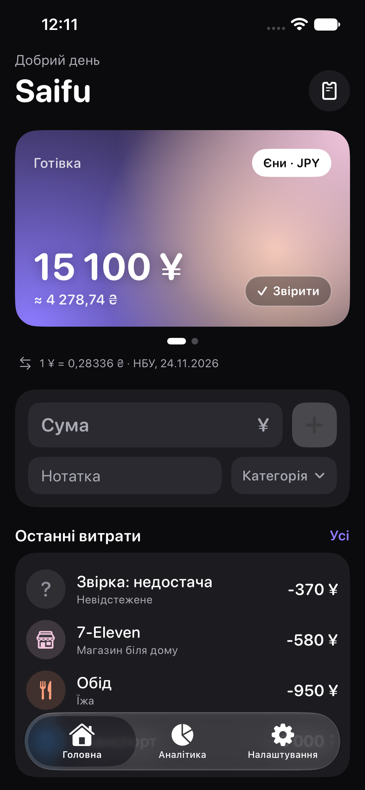
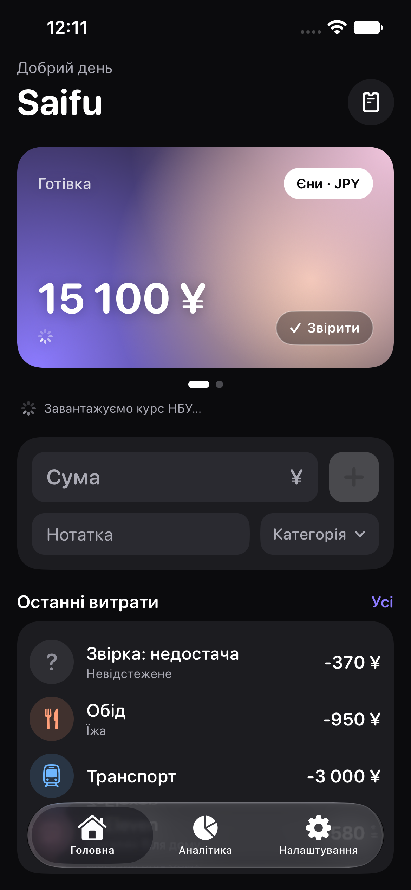
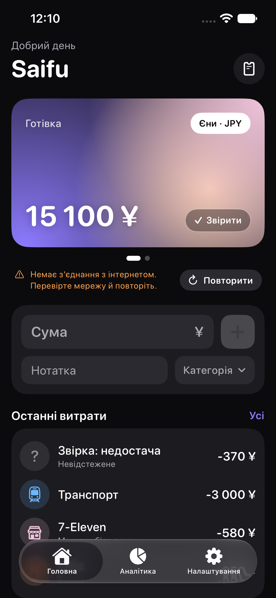
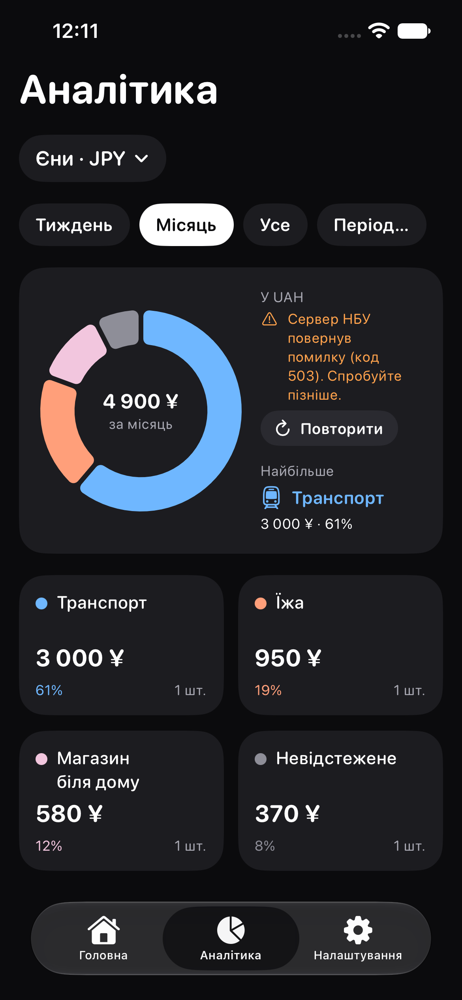

# Saifu

Saifu — iOS-застосунок для обліку готівкових витрат у будь-якій країні та валюті.

## Призначення

Готівку складно відстежувати: дрібні витрати не записуються, і підрахунок у застосунку «не сходиться» з тим, що реально лежить у гаманці. Saifu розв'язує це так: гаманець має **очікуваний баланс**, який рахується з поповнень і записаних витрат. Час від часу користувач **звіряє** його з реальною готівкою, а різниця записується як «невідстежені витрати».

Демо-приклад — Японія, де багато платять готівкою (єни).

## Користувач

Людина, яка часто платить готівкою. Зокрема:
- студент;
- мандрівник за кордоном, який хоче бачити витрати ще й у домашній валюті.

## Сценарії

1. **Поповнити гаманець** (зняття готівки в банкоматі).
2. **Швидко записати витрату** (сума, категорія, нотатка).
3. **Звірити гаманець із реальною готівкою**: ввести фактичну суму, а різницю зберегти як невідстежені витрати.
4. **Переглянути витрати за категорією.**
5. **Побачити суму витрат за період.**

## Сутності

Одна валюта на гаманець. Усі суми — `Int` у найменших одиницях валюти (єни, копійки, центи), ніколи не `Double`.

| Сутність | Призначення | Властивості |
|---|---|---|
| `Currency` | Валюта (enum) | `code` (наприклад, JPY, UAH, USD), `symbol`, `minorUnits` (кількість знаків після коми) |
| `Expense` | Витрата (`Identifiable`) | `let id: UUID`, `amount: Int` (у найменших одиницях), `category`, `date`, `note?`, `receiptID?` |
| `CashTopUp` | Поповнення гаманця (`Identifiable`) | `let id: UUID`, `amount`, `date`, `source: TopUpSource` |
| `TopUpSource` | Джерело поповнення (enum) | `atm` (банкомат), `correction` (коригувальне поповнення при надлишку) |
| `CashWallet` | Гаманець | `name`, `currency`, `expenses`, `topUps`, `lastReconciliation?` |
| `Reconciliation` | Результат звірки | `expected`, `actual`, `difference`, `date` |
| `WalletError` | Помилка операції з гаманцем (enum, `Error`) | `negativeAmount` (від'ємна або нульова сума витрати чи поповнення, від'ємна фактична готівка) |

`id` потрібен для пошуку `expense(with id:)`, для `List` у SwiftUI та для передачі `Expense.ID` між екранами.

Зв'язки:
- `CashWallet` має одну `Currency`.
- `CashWallet` має багато `Expense` і `CashTopUp`, а також останню звірку `lastReconciliation` (необов'язкова).
- Баланс = сума поповнень − сума витрат.
- Різниця: `difference = expected − actual`.
  - Недостача (`difference > 0`): записується витрата категорії `untracked`.
  - Надлишок (`difference < 0`): записується коригувальне поповнення із `source: .correction`.
- `addExpense`, `addTopUp` і `reconcile` кидають `WalletError.negativeAmount` при некоректній сумі.

Категорії загальні для всіх країн. Місцева специфіка (наприклад, назви магазинів) не входить у моделі, лише у словники підказки категорії.

## Технічні вимоги

| | |
|---|---|
| Xcode | 27.2 |
| Мінімальна iOS | 17.0 (API новіших версій — лише через `if #available`, наприклад Tab API з iOS 18 і Liquid Glass-панель з iOS 26) |
| Мова / UI | Swift, SwiftUI |
| Збереження | SwiftData (на пристрої); налаштування — `UserDefaults`; резервна копія — JSON у «Файлах» |
| Bundle ID | `com.vitaliilazariev.Saifu` |

### Підготовка і запуск

1. Клонувати репозиторій:
   ```sh
   git clone https://github.com/shelovesme0/Saifu.git
   cd Saifu
   ```
2. Відкрити `Saifu.xcodeproj` в Xcode 27.2. Проєкт використовує новий JSON-формат (`project.xcproj` замість `project.pbxproj`), тому старіші версії Xcode його не відкриють.
3. Вибрати схему `Saifu` і симулятор iPhone.
4. Запустити (⌘R) або зібрати з терміналу:
   ```sh
   xcodebuild -scheme Saifu -destination 'platform=iOS Simulator,name=iPhone 16' build
   ```
   Назву симулятора замініть на ту, що встановлена (`xcrun simctl list devices available`).

## Де реалізовано конструкції Swift

| Конструкція | Файл | Тип/метод | Пояснення |
|---|---|---|---|
| `struct` | `Models/Expense.swift` | `Expense` | Значеннєвий тип: витрата копіюється при передачі |
| `struct` | `Models/CashTopUp.swift`, `Models/Reconciliation.swift` | `CashTopUp`, `Reconciliation` | Поповнення та результат звірки |
| `class` | `Models/CashWallet.swift` | `CashWallet` | Посилальний тип: один гаманець спільний для екранів, змінюється на місці |
| `protocol` | `Models/WalletEntry.swift` | `WalletEntry` | Спільний контракт `Expense` і `CashTopUp` (`amount`, `date`, `signedAmount`) |
| `enum` | `Models/Currency.swift` | `Currency` | Валюти з `rawValue` і `CaseIterable` |
| `enum` | `Models/ExpenseCategory.swift`, `Models/CashTopUp.swift`, `Models/WalletError.swift` | `ExpenseCategory`, `TopUpSource`, `WalletError` | Категорії, джерело поповнення, помилка гаманця (`Error`) |
| `let` | `Models/Expense.swift` | `Expense.id`, `Expense.date` | Незмінні після створення |
| `var` | `Models/Expense.swift` | `Expense.amount`, `Expense.category` | Змінювані значення |
| `var` (локальна) | `Models/Currency.swift` | `format(_:)` — `divisor`, `result` | Локальні змінні, що змінюються в циклі |
| Збережені властивості | `Models/CashWallet.swift` | `name`, `currency`, `lastReconciliation` | Дані гаманця; `private(set) var expenses`/`topUps` читаються ззовні, змінюються лише методами |
| Обчислювані властивості | `Models/Currency.swift`, `Models/CashWallet.swift`, `Models/Reconciliation.swift` | `Currency.code`/`symbol`/`minorUnits`, `CashWallet.expectedBalance`/`formattedBalance`, `Reconciliation.difference`, `Expense.signedAmount` | Значення рахуються з інших даних і не зберігаються |
| Методи | `Models/CashWallet.swift` | `addTopUp`, `addExpense`, `expense(with:)`, `expenses(in:)`, `totalsByCategory()`, `reconcile(actualCash:)` | Поведінка гаманця |
| `mutating` метод | `Models/Expense.swift` | `Expense.update(category:amount:)` | Змінює `struct` на місці |
| `init` | `Models/Expense.swift`, `Models/CashTopUp.swift`, `Models/Reconciliation.swift`, `Models/CashWallet.swift` | `Expense.init(...)`, `CashTopUp.init(...)`, `Reconciliation.init(...)`, `CashWallet.init(name:currency:)` | Ініціалізатори; у `struct` — зі значеннями за замовчуванням (`id`, `date`) |
| Колекції | `Models/CashWallet.swift` | `[Expense]`, `[CashTopUp]`, `[ExpenseCategory: Int]` | Масиви записів і словник підсумків |
| Optional | `Models/Expense.swift`, `Models/CashWallet.swift` | `Expense.note`, `Expense.receiptID`, `CashWallet.lastReconciliation` | Значення може бути відсутнім (`nil`) |
| `if let` | `Models/Expense.swift`, `ContentView.swift`, `Demo/DemoScenario.swift` | `Expense.update`, `ContentView.row`, `DemoScenario.run()` (крок 6) | Безпечне розгортання optional |
| `??` | `Models/CashWallet.swift`, `Demo/DemoScenario.swift` | `totalsByCategory()`, `describe(_:in:)` | Значення за замовчуванням для `nil` (0 або «без нотатки») |
| `guard` | `Models/CashWallet.swift` | `addTopUp`, `addExpense`, `reconcile(actualCash:)` | Рання відмова при некоректній сумі. `guard let` у коді не використовується |
| `if` | `Models/Currency.swift` | `format(_:)`, `groupThousands(_:)` | Умови: дробова частина лише для валют із копійками, пробіл між тисячами |
| `switch` | `Models/Currency.swift`, `Models/ExpenseCategory.swift`, `Models/CashWallet.swift` | `symbol`, `minorUnits`, `title`, `emoji`, `reconcile(actualCash:)` | Розгалуження по enum та по знаку різниці |
| `for-in` | `Models/CashWallet.swift`, `Models/Currency.swift`, `Demo/DemoScenario.swift` | `totalsByCategory()`, `format(_:)`, `groupThousands(_:)`, `run()` | Перебір записів, цифр, категорій |
| `filter` | `Models/CashWallet.swift` | `expenses(in:)` | Витрати однієї категорії |
| `map` | `Models/CashWallet.swift`, `Demo/DemoScenario.swift` | `expenseSummaries()`, `run()` (крок 3) | Перетворення витрат на рядки |
| `reduce` | `Models/CashWallet.swift` | `expectedBalance` | Баланс як сума `signedAmount` по всіх записах |
| `throws` | `Models/CashWallet.swift` | `addTopUp`, `addExpense`, `reconcile(actualCash:)` | Методи кидають `WalletError.negativeAmount` |
| `do` / `try` / `catch` | `Demo/DemoScenario.swift` | `run()` (кроки 2–8) | Виклики, що кидають помилки; у кроці 8 перехоплюється `WalletError.negativeAmount` |

## Як перевірити сценарій

1. Відкрити `Saifu.xcodeproj` в Xcode 27.2 або новішому.
2. Обрати симулятор iPhone.
3. Запустити застосунок (⌘R).
4. Відкрити консоль (⇧⌘C).

Під час першого запуску гаманців немає: на головній буде кнопка «Створити перший гаманець». Демо-гаманці «Єни» та «Гривні» показують `#Preview` і запуск у Debug з аргументом `-uiScreen` (наприклад, `xcrun simctl launch booted com.vitaliilazariev.Saifu -uiScreen wallets`). У такому режимі консоль друкує сценарій із 8 кроків:

1. **Створення гаманця «Єни» (JPY).**
2. **Поповнення:** `+ 20 000 ¥`.
3. **Витрати:** 7-Eleven 580 ¥, обід 950 ¥ та ICOCA 3 000 ¥ (остання без нотатки, виводиться «без нотатки»).
4. **Очікуваний баланс:** `15 470 ¥`.
5. **Звірка:** у гаманці реально 15 100 ¥, недостача `370 ¥` записується як «Невідстежене».
6. **Витрати за категоріями** (🏪 580 ¥, 🍜 950 ¥, 🚆 3 000 ¥, ❓ 370 ¥) і баланс після звірки: `15 100 ¥`.
7. **Гаманець «Гривні» (UAH):** `+ 1 000,00 ₴, − 45,50 ₴`, баланс `954,50 ₴`.
8. **Від'ємна сума:** перехоплена помилка `WalletError.negativeAmount`, у консолі «Помилка: сума має бути додатною, витрату не додано», баланс лишається `954,50 ₴`.

Системні повідомлення симулятора в кінці консолі не є помилками застосунку.

## Практична робота 2: архітектура

Проєкт переведено на MVVM (`View` → `ViewModel` → `Repository`). Додано три патерни: Builder (`ExpenseBuilder`), Strategy (`CategorySuggestionStrategy`) і Adapter (`NBURateAdapter`). Залежності створюються в одному місці, `SaifuApp`.

Схема компонентів, опис патернів, SOLID, антипатерни (було → стало) та інструкція зі заміни джерел даних: [docs/architecture.md](docs/architecture.md).

Курси валют тоді бралися з `DemoNBURecordSource` (ілюстративні). У лабі 4 їх замінили реальні курси НБУ.

## Практична робота 3: екрани й навігація

Інтерфейс перероблено в темному стилі (`Theme.swift`) і розкладено на три вкладки нативного `TabView` — Головна, Аналітика, Налаштування — у кожної свій `NavigationStack`. Усі переходи йдуть через `AppRouter`: він зберігає обрану вкладку, шлях кожної вкладки й поточний sheet, а `ScreenFactory` створює екрани з їхніми ViewModel.

- **Головна:** свайп-картки гаманців із балансом і «≈ …» у домашній валюті, вбудована форма швидкого додавання витрати (категорія підставляється за нотаткою), останні витрати.
- **Усі витрати → деталі:** фільтр категорій, групування за днями, редагування й видалення з підтвердженням.
- **Звірка (sheet):** анімований бейдж різниці — сходиться / недостача / надлишок.
- **Гаманці (sheet):** додавання, перейменування, видалення свайпом і зміна порядку.
- **Аналітика:** кругова діаграма Swift Charts, періоди «Тиждень / Місяць / Усе / Період…», картки категорій.
- **Налаштування:** домашня валюта, нагадування звірити гаманець у вибраний час (локальні сповіщення).

Поле суми пропускає лише цифри й одну кому, не більше `minorUnits` знаків після неї. Екрани оновлюються самі, бо `CashWallet` — `@Observable`, а маршрути передають лише ID гаманця й витрати.

Карта переходів, роль `AppRouter`, передача даних, анімації, покрокова інструкція й скриншоти (iPhone 13 Pro та iPhone SE): [docs/navigation.md](docs/navigation.md). Оновлена схема архітектури: [docs/architecture.md](docs/architecture.md).

Перевірено в Xcode 27.2, мінімальна версія iOS — 17.0.

## Збереження даних

Гаманці, витрати, поповнення, звірки й порядок гаманців зберігаються на пристрої через SwiftData і після перезапуску лишаються на місці. Доменні моделі не змінювалися на `@Model`: сховище описують окремі сутності в `Saifu/Persistence/` (`WalletEntity`, `ExpenseEntity`, `TopUpEntity`, `ReconciliationEntity`, схема `SaifuSchemaV1` з планом міграцій). `SwiftDataWalletRepository` реалізує той самий протокол `WalletRepository`, тому ViewModel не змінилися. Видалення гаманця каскадно видаляє його записи. Помилка запису не валить застосунок: користувач бачить повідомлення.

- **Перший запуск:** порожній стан із кнопкою «Створити перший гаманець».
- **Демо-дані:** лише в `#Preview` і в Debug із `-uiScreen` (у пам'яті, збережене на диску не змінюється).
- **Налаштування** (домашня валюта, нагадування) лишаються в `UserDefaults`.
- **Почати з нуля на симуляторі:** видалити застосунок або `xcrun simctl uninstall booted com.vitaliilazariev.Saifu`.

Чому SwiftData, чому окремі сутності й як підміняється репозиторій: [docs/architecture.md](docs/architecture.md#збереження-даних).

## Резервна копія

Налаштування → «Резервна копія» (функція поза лабами, без нових capabilities):

- **«Автоматична резервна копія»** — один раз вибрати папку (на iPhone або в iCloud Drive). `Saifu-latest.json` перезаписується через ~3 с після кожної зміни даних (серія змін — один запис; при виході у фон — одразу), лише якщо дані справді змінилися. Щоденні знімки `Saifu-backup-YYYY-MM-DD.json` — не частіше одного на день, лишаються 7 найновіших. Якщо доступ до папки втрачено, з'являються попередження і кнопка «Вибрати папку знову».
- **«Експортувати зараз»** — зберегти копію будь-куди у «Файлах».
- **«Імпортувати»** — файл спершу перевіряється (пошкоджений або невідомої версії дає зрозумілу помилку, дані не змінюються). Після підтвердження поточні дані зберігаються у `Saifu-before-import-…json` і замінюються даними з копії, усі екрани оновлюються.
- Під секцією видно час останнього запису автокопії.

Формат JSON (окремі DTO з `formatVersion`), правила перевірки й покрокова перевірка на симуляторі: [docs/backup.md](docs/backup.md).

## Практична робота 4: взаємодія із сервером

Курси валют для «≈ …» у домашній валюті тепер надходять з відкритого API НБУ (`GET https://bank.gov.ua/NBUStatService/v1/statdirectory/exchange?valcode=<CODE>&json`, без авторизації).

- **Мережевий шар** (`Saifu/Networking/`): `HTTPClient` і `URLSessionHTTPClient` на async/await, `NetworkError` (`transport`, `badStatus`, `decoding`, `empty`). Статус відповіді перевіряється до декодування. View і ViewModel мережу не викликають.
- **Дані:** `NBURateDTO` → `NBURecord` → `NBURateAdapter` (не змінювався) → `ExchangeRate`. `NBURemoteRecordSource` замінив `DemoNBURecordSource`, який лишився для `#Preview`.
- **Стани в UI:** `LoadState` (`idle`, `loading`, `loaded`, `empty`, `failed`). На картці гаманця під час завантаження показується `ProgressView`, під картками — курс із датою НБУ або повідомлення про помилку з кнопкою «Повторити». Те саме в аналітиці.
- **Кеш:** курс на день запитується один раз (3 запити: JPY, USD, EUR). Свайпи й вкладки мережу не чіпають. Pull-to-refresh на головній завантажує курс наново.
- **Debug:** налаштування → «Розробка» → «Джерело курсів»: реальне API або mock-режими (успіх, порожньо, немає мережі, помилка сервера, неправильний формат, повільно). Аргумент запуску `-rateSource <режим>` робить те саме. У Release перемикача немає.

| Курс завантажено | Завантаження | Немає мережі | Аналітика: помилка сервера |
|---|---|---|---|
|  |  |  |  |

Endpoint, параметри, реальні відповіді, схема мережевого шару й покрокова перевірка кожного стану: [docs/api.md](docs/api.md). Оновлена архітектура: [docs/architecture.md](docs/architecture.md#мережевий-шар).

## Внесок учасників

Індивідуальна робота.
