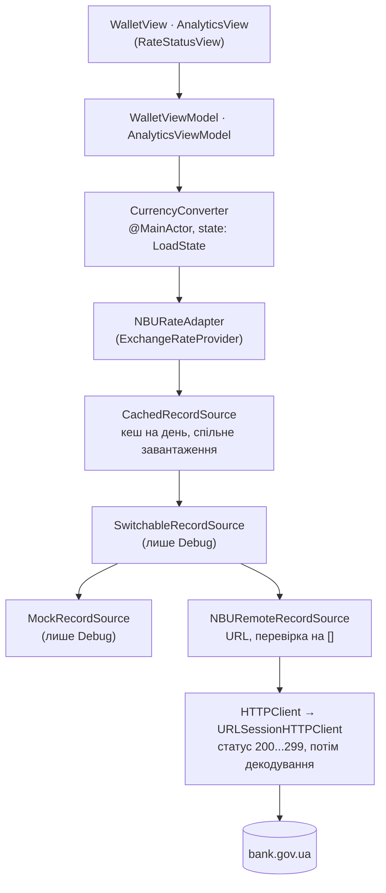
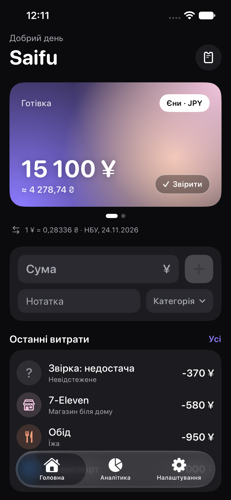
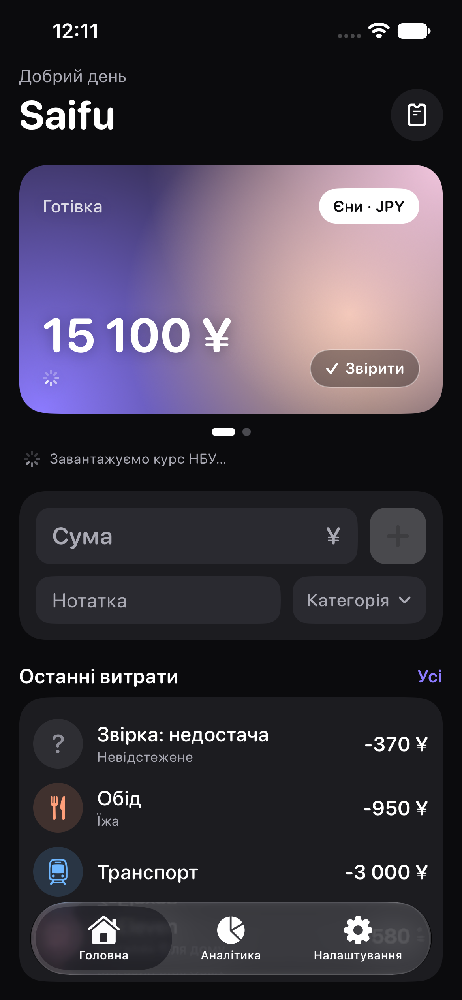
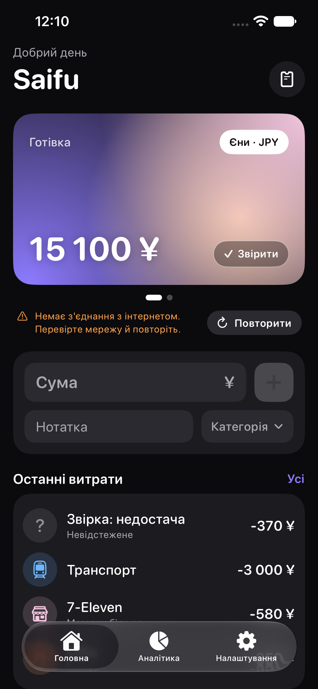
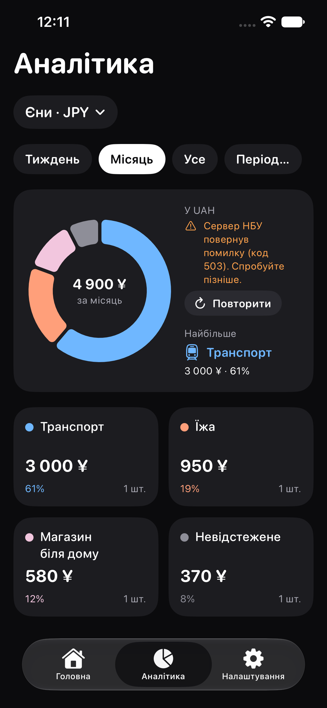
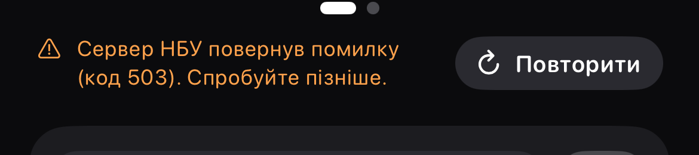
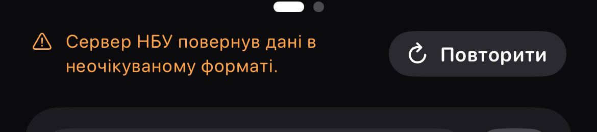

# API курсів НБУ

Практична робота 4: Saifu отримує офіційні курси валют Національного банку України і перераховує в них баланси гаманців («≈ …» у домашній валюті).

## Endpoint

| | |
|---|---|
| Базова адреса | `https://bank.gov.ua/NBUStatService/v1/statdirectory` |
| Endpoint | `GET /exchange` |
| Авторизація | не потрібна (відкритий API, без ключів і заголовків) |
| Формат | JSON, якщо є параметр `json`; без нього сервер повертає XML |
| Код у застосунку | `Saifu/ExchangeRates/NBURemoteRecordSource.swift` |

### Параметри запиту

| Параметр | Обов'язковий | Приклад | Опис |
|---|---|---|---|
| `valcode` | ні (у застосунку завжди) | `JPY` | Літерний код валюти ISO 4217, регістр не важливий. Без нього повертаються всі валюти (~60 записів) |
| `date` | ні | `20261124` | Дата курсу у форматі `yyyyMMdd`. Без неї повертається курс на сьогодні |
| `json` | так | `json` | Параметр без значення, вмикає JSON |

Застосунок робить по одному запиту на кожну валюту, крім гривні (JPY, USD, EUR). Запити йдуть паралельно:

```
GET https://bank.gov.ua/NBUStatService/v1/statdirectory/exchange?valcode=JPY&json
```

### Приклад реальної відповіді (24.11.2026)

`200 OK`, `Content-Type: application/json; charset=utf-8`:

```json
[
{
"r030":392,"txt":"Єна","rate":0.28336,"cc":"JPY","exchangedate":"24.11.2026","special":null
 }
]
```

| Поле | Тип | Значення |
|---|---|---|
| `r030` | Int | Цифровий код валюти (392 — єна) |
| `txt` | String | Назва українською |
| `rate` | Decimal | Скільки гривень коштує 1 одиниця валюти |
| `cc` | String | Літерний код |
| `exchangedate` | String | Дата курсу, `dd.MM.yyyy` |
| `special` | String? | Службова позначка (`null` або `"N"`), застосунок її ігнорує |

У коді цьому відповідає `NBURateDTO` (`Decodable`), який перетворюється на `NBURecord`, а `NBURateAdapter` робить з нього `ExchangeRate`. `rate` декодується в `Decimal`, а суми рахуються в найменших одиницях без `Double`.

### Як сервер поводиться в нестандартних випадках

Перевірено реальними запитами:

| Запит | Відповідь | Як обробляє застосунок |
|---|---|---|
| `valcode=XXX` (неіснуючий код) | `200`, тіло `[]` | `NetworkError.empty` → стан «порожньо» |
| `date=20991231` (курсу ще немає) | `200`, тіло `[]` | `NetworkError.empty` |
| `date=abc` (неправильна дата) | `200`, тіло `[{ Wrong date format }]`, не JSON | `NetworkError.decoding` |
| неправильний шлях (`/statdirectoryZZ/exchange`) | `502` | `NetworkError.badStatus(502)` |
| без параметра `json` | `200`, XML | у застосунку не трапляється: `json` додається завжди |

Отже, помилку «даних немає» НБУ повертає як успішну відповідь з порожнім масивом, тому `NBURemoteRecordSource` сам перевіряє, що масив не порожній.

## Схема мережевого шару



У Release `CachedRecordSource` звертається до `NBURemoteRecordSource` напряму, `SwitchableRecordSource` і `MockRecordSource` у збірку не потрапляють (`#if DEBUG`).

**Файли:**

- `Saifu/Networking/NetworkError.swift`, `HTTPClient.swift`, `URLSessionHTTPClient.swift`: мережевий шар, єдине місце з URLSession.
- `Saifu/ExchangeRates/NBURateDTO.swift`, `NBURemoteRecordSource.swift`, `CachedRecordSource.swift`: дані НБУ.
- `Saifu/ExchangeRates/MockRecordSource.swift`, `RateSourceMode.swift`: mock і перемикач джерела (Debug).
- `Saifu/ViewModels/LoadState.swift`, `NetworkError+Message.swift`: стан і тексти для UI.
- `Saifu/Services/CurrencyConverter.swift`: завантаження, стан, перерахунок.
- `Saifu/Views/Components/RateStatusView.swift`: показ стану.

### Порядок обробки відповіді (`URLSessionHTTPClient.get`)

1. `session.data(from:)`. `URLError` (немає мережі, таймаут 15 с, DNS) → `NetworkError.transport`.
2. Статус `HTTPURLResponse` поза `200...299` → `NetworkError.badStatus(код)`. Тіло з помилкою не декодується.
3. Порожнє тіло → `NetworkError.empty`.
4. `JSONDecoder` → помилка → `NetworkError.decoding`.
5. `NBURemoteRecordSource`: усі масиви порожні → `NetworkError.empty`.

### Помилки й повідомлення

| `NetworkError` | `LoadState` | Повідомлення |
|---|---|---|
| `transport` (`notConnectedToInternet`, `networkConnectionLost`) | `failed` | Немає з'єднання з інтернетом. Перевірте мережу й повторіть. |
| `transport` (`timedOut`) | `failed` | Сервер НБУ не відповідає. Спробуйте трохи пізніше. |
| `transport` (інше) | `failed` | Не вдалося з'єднатися з сервером НБУ. |
| `badStatus(n)` | `failed` | Сервер НБУ повернув помилку (код n). Спробуйте пізніше. |
| `decoding` | `failed` | Сервер НБУ повернув дані в неочікуваному форматі. |
| `empty` | `empty` | НБУ ще не опублікував курс на сьогодні. |

У станах `failed` і `empty` поруч є кнопка «Повторити». Скасований запит (наприклад, якщо екран закрили під час pull-to-refresh) помилкою не вважається.

### Потоки

`CurrencyConverter` позначений `@MainActor`, тому `state` і курси змінюються на головному потоці. Сам запит виконує URLSession у своїх чергах, а `await` лише чекає на результат, не блокуючи UI. Під час режиму «повільно» можна гортати картки й додавати витрати.

### Кеш

- `CachedRecordSource` зберігає записи з ключем дня `yyyyMMdd` за київським часом (так НБУ публікує курси). Протягом дня всі звернення беруться з пам'яті.
- `NBURateAdapter` викликає `records()` для кожної валюти, але мережа використовується лише першого разу: решта отримує той самий результат. Разом виходить 3 HTTP-запити на день.
- Свайпи карток і перехід між вкладками курс не запитують: екрани беруть уже завантажені значення з `CurrencyConverter`.
- `loadIfNeeded()` викликається при запуску і поверненні застосунку на передній план. Якщо курс за сьогодні вже є, нічого не відбувається, а коли настав новий день, курс завантажується знову.
- Скидають кеш pull-to-refresh на головній, «Повторити» і зміна джерела в Debug.
- URLSession налаштовано без власного HTTP-кешу (`reloadIgnoringLocalCacheData`), щоб pull-to-refresh справді йшов на сервер.

## Покрокова перевірка станів

Потрібні Debug-збірка (Xcode → Run) і гаманець у валюті, що відрізняється від домашньої (наприклад, гаманець JPY і домашня валюта UAH). Джерело перемикається в **Налаштування → Розробка → Джерело курсів**, після вибору курс одразу завантажується наново. Те саме з терміналу: `xcrun simctl launch booted com.vitaliilazariev.Saifu -rateSource <режим>` (додайте `-uiScreen home`, щоб працювати з демо-гаманцями).

| # | Стан | Режим (`-rateSource`) | Що робити | Очікуваний результат |
|---|---|---|---|---|
| 1 | Успіх | Реальне API НБУ (`live`) | Відкрити головну | На картці «≈ 4 278,74 ₴» (15 100 ¥ × 0,28336), під картками «1 ¥ = 0,28336 ₴ · НБУ, 24.11.2026». В аналітиці «У UAH ≈ …» |
| 2 | Завантаження | Mock: повільно (`mockSlow`) | Вибрати режим, одразу перейти на головну | ~3 с на картці `ProgressView`, під картками «Завантажуємо курс НБУ…». Картки гортаються, витрату можна додати. Потім курс |
| 3 | Порожньо | Mock: порожньо (`mockEmpty`) | Вибрати режим | «НБУ ще не опублікував курс на сьогодні.» і «Повторити» |
| 4 | Немає мережі | Mock: немає мережі (`mockTransportError`) | Вибрати режим | Помаранчеве «Немає з'єднання з інтернетом…» і «Повторити» |
| 5 | Помилка сервера | Mock: помилка сервера (`mockBadStatus`) | Вибрати режим | «Сервер НБУ повернув помилку (код 503)…» і «Повторити». В аналітиці те саме в блоці «У UAH» |
| 6 | Неправильний формат | Mock: неправильний формат (`mockDecodingError`) | Вибрати режим | «Сервер НБУ повернув дані в неочікуваному форматі.» і «Повторити» |
| 7 | Повтор | після 3–6 вибрати «Mock: успіх» або «Реальне API» | Натиснути «Повторити» або змінити режим | Курс з'являється |
| 8 | Кеш і оновлення | Реальне API | Погортати картки, перейти на аналітику й назад, потім потягнути головну вниз | Під час гортання запитів немає, спінер не з'являється. Pull-to-refresh показує системний індикатор і запитує курс наново |

Реальну відсутність мережі можна перевірити й без mock: на фізичному iPhone увімкнути авіарежим, на головній потягнути вниз. Має з'явитися стан 4 (`URLError.notConnectedToInternet`).

| Успіх | Завантаження | Немає мережі | Аналітика: помилка сервера |
|---|---|---|---|
|  |  |  |  |

Порожньо, помилка сервера, неправильний формат:




