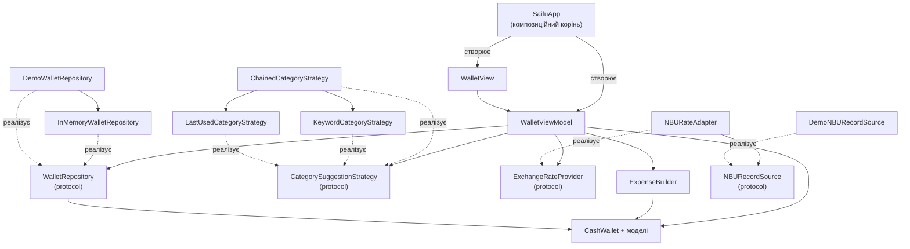

# Архітектура Saifu

Практична робота 2: MVVM, патерни Builder / Strategy / Adapter, принципи SOLID.

## Чому MVVM

- **MVC.** У SwiftUI роль контролера відсутня. Логіка опинилася б у `View` або в моделі. Саме так було до рефакторингу: `ContentView` вибирав заголовки рядків і кольори, а `CashWallet` повертав відформатовані рядки.
- **VIPER.** Дає п'ять шарів на кожен екран (View, Interactor, Presenter, Entity, Router). Для застосунку з одним екраном і однією бізнес-операцією це багато шаблонного коду без користі.
- **MVVM.** Підходить до `@Observable` і декларативного UI. View лише показує стан і викликає методи ViewModel. ViewModel отримує залежності через `init`, тому їх легко підміняти. Для лаби 3 (п'ять екранів із Router) каркас розширюється додаванням нових ViewModel, а не переписуванням.

## Схема компонентів

Стрілка означає «залежить від».



`WalletView` не знає про репозиторій, стратегію та курси. Усі вони доступні лише через `WalletViewModel`. Конкретні типи (`DemoWalletRepository`, `ChainedCategoryStrategy`, `NBURateAdapter`, `DemoNBURecordSource`) створюються тільки в `SaifuApp`.

## Патерни

### Builder: `ExpenseBuilder`

- **Задача.** Перетворити введення форми (рядок «45,50», необов'язкові категорія й нотатка) на коректну `Expense`. Суму треба перевести в найменші одиниці за `currency.minorUnits` без `Double` і перевірити: сума більша за нуль, категорію задано.
- **Учасники.** `ExpenseBuilder` (будівельник), `Expense` (продукт), `WalletError` (`invalidAmount`, `negativeAmount`, `missingCategory`), `WalletViewModel` (клієнт).
- **Особливість.** Методи `amount`, `category`, `note`, `date` повертають копію структури, тож будівельник є значенням без прихованого стану.
- **Файли.** `Saifu/Builders/ExpenseBuilder.swift`, `Saifu/Models/WalletError.swift`, використання в `Saifu/ViewModels/WalletViewModel.swift`.

### Strategy: `CategorySuggestionStrategy`

- **Задача.** Підказувати категорію за нотаткою. Спосіб підказки має змінюватися без правок ViewModel.
- **Учасники.**
  - Протокол `CategorySuggestionStrategy` (`suggest(for:)`, `learn(note:category:)` зі стандартною порожньою реалізацією).
  - `KeywordCategoryStrategy(dictionary:)` шукає цілі слова та фрази без урахування регістру, найдовший збіг виграє.
  - `LastUsedCategoryStrategy` пригадує категорію, яку користувач уже обирав для такої нотатки.
  - `CategoryDictionaries` містить дані (`english`, `ukrainian`, `all`).
  - Контекст — `WalletViewModel`.
- **Файли.** `Saifu/Strategies/*.swift`.

#### Роль `ChainedCategoryStrategy`

`WalletViewModel` приймає одну стратегію, а застосунку потрібні дві: спочатку те, що користувач уже обирав, і лише потім словник. `ChainedCategoryStrategy` реалізує той самий протокол і перебирає вкладені стратегії по черзі. Повертається перша відповідь, а `learn` передається всім. Порядок у масиві задає пріоритет. ViewModel не знає, що за стратегією ховається кілька. Так само працює патерн Composite, і це не штучна ієрархія: тип замінює складну умову у ViewModel.

### Adapter: `NBURateAdapter`

- **Задача.** Дані НБУ мають власний формат (`r030`, `txt`, `rate`, `cc`, `exchangedate` у вигляді `dd.MM.yyyy`). Застосунок працює зі своїм типом `ExchangeRate`.
- **Учасники.**
  - `ExchangeRateProvider` — цільовий інтерфейс, його використовує ViewModel.
  - `NBURecord` — формат, що адаптується.
  - `NBURateAdapter` — адаптер. Невідомий код валюти або дата, що не розбирається, дають `nil`.
  - `NBURecordSource` — джерело записів, `DemoNBURecordSource` — його демо-реалізація.
- **Конвертація.** `ExchangeRate.toUAHMinor` рахує через `Decimal`, без `Double`.
- **Файли.** `Saifu/ExchangeRates/*.swift`.

> **Примітка.** Курси в `DemoNBURecordSource` ілюстративні. Реальні дані з API НБУ з'являться в лабі 4.

## SOLID у Saifu

**S: єдина відповідальність.**
- `ExpenseBuilder` лише збирає й перевіряє витрату.
- `NBURateAdapter` лише перетворює формат.
- `EntryRow` лише готує рядок для показу.
- Чесне застереження: `WalletViewModel` усе ще поєднує вибір гаманця, логіку форми, підготовку рядків і конвертацію. Усе це стан одного екрана, і поки він один, ділити клас немає сенсу. З появою екранів у лабі 3 його варто розбити.

**O: відкритість до розширення.**
- Новий словник додається у `CategoryDictionaries` одним `static let`, класи стратегій не змінюються.
- Нова стратегія додається в `ChainedCategoryStrategy([...])` у `SaifuApp`.

**L: підстановка Лісков.**
- Будь-яка реалізація `WalletRepository`, `CategorySuggestionStrategy` чи `ExchangeRateProvider` замінює іншу без змін у ViewModel.
- Наприклад, `InMemoryWalletRepository` і `DemoWalletRepository` взаємозамінні, а `ChainedCategoryStrategy` сама є стратегією.
- Спадкування тут не використовується, тому принцип виявляється лише через протоколи.

**I: розділення інтерфейсів.**
- `NBURecordSource` має один метод, `ExchangeRateProvider` також один.
- `learn(note:category:)` має стандартну порожню реалізацію, тому `KeywordCategoryStrategy` не змушений реалізовувати непотрібне.
- Чесне застереження: `WalletRepository` має два методи і для поточного екрана ділити його не потрібно.

**D: інверсія залежностей.**
- `WalletViewModel` залежить від протоколів `WalletRepository`, `CategorySuggestionStrategy`, `ExchangeRateProvider` і отримує їх через `init`. Конкретні типи створюються лише у `SaifuApp`.
- Чесне застереження: ViewModel напряму використовує `CashWallet` і `ExpenseBuilder`. Це доменні типи з єдиною реалізацією, тож абстракція над ними була б штучною.

## Як замінити джерела без зміни ViewModel

Усі залежності обираються в `Saifu/App/SaifuApp.swift`.

**Репозиторій.** Демо-дані замість порожнього старту (або навпаки):

```swift
// порожній старт
WalletViewModel(repository: InMemoryWalletRepository(), ...)

// дані демо-сценарію (гаманці JPY і UAH)
WalletViewModel(repository: DemoWalletRepository(), ...)
```

**Джерело курсів.** Достатньо написати тип, що реалізує `NBURecordSource`, і підставити його в адаптер:

```swift
struct NBUAPIRecordSource: NBURecordSource {
    func records() async throws -> [NBURecord] {
        // запит до API НБУ і декодування [NBURecord]
    }
}

// SaifuApp
rateProvider: NBURateAdapter(source: NBUAPIRecordSource())
```

`NBURecord` уже `Decodable`, а `ExchangeRateProvider` вже асинхронний, тому `WalletViewModel` лишається без змін.

## Таблиця: патерн / принцип, компонент, призначення

| Патерн / принцип | Компонент | Призначення |
|---|---|---|
| MVVM | `WalletView` / `WalletViewModel` / моделі | Розділення показу, стану екрана й домену |
| Repository | `WalletRepository`, `InMemoryWalletRepository`, `DemoWalletRepository` | Джерело гаманців, яке можна підміняти |
| Builder | `ExpenseBuilder` | Збирання і валідація `Expense` з введення форми |
| Strategy | `CategorySuggestionStrategy`, `KeywordCategoryStrategy`, `LastUsedCategoryStrategy` | Взаємозамінні способи підказати категорію |
| Composite (за роллю) | `ChainedCategoryStrategy` | Кілька стратегій як одна |
| Adapter | `NBURateAdapter` | Формат НБУ → `ExchangeRate` |
| Composition root | `SaifuApp` | Єдине місце створення залежностей |
| S | `ExpenseBuilder`, `NBURateAdapter`, `EntryRow` | Кожен тип має одну задачу |
| O | `CategoryDictionaries` | Новий словник без змін класів |
| L | реалізації протоколів репозиторію, стратегії, курсів | Підстановка без змін ViewModel |
| I | `NBURecordSource`, `learn` зі стандартною реалізацією | Вузькі інтерфейси |
| D | `WalletViewModel` | Залежність від протоколів, а не від конкретних типів |

## Антипатерни: було → стало

Перевірка коду на антипатерни дала такі виправлення (коміт «Fix antipatterns found in architecture review»).

| Що | Було | Стало |
|---|---|---|
| Надмірна відповідальність | `WalletViewModel` сам збирав рядки операцій (заголовок, емодзі, знак, текст суми) двома блоками майже однакового коду | Рядки будують `EntryRow.init(topUp:currency:)` та `EntryRow.init(expense:currency:)` у `ViewModels/EntryRow.swift`, ViewModel лише викликає їх |
| UI з прямим доступом до даних | `WalletViewModel.wallets` та `selectedWallet` були доступні ззовні, тож `View` міг дістатися до `CashWallet` | Обидві властивості `private`, `View` бачить лише `walletNames`, `balanceText`, `rows` та інший готовий стан |
| Дублювання | Злиття словників `english` та `ukrainian` повторювалось у `SaifuApp` і в `#Preview` | Одне місце: `CategoryDictionaries.all` |
| Прихована залежність | `DemoWalletRepository.init()` всередині викликав `DemoScenario.run()`, залежність не було видно в сигнатурі | `init(wallets: [CashWallet] = DemoScenario.run())`: залежність явна, її можна замінити |

**Чого в коді немає і чому.**
- **Синглтони та змінний статичний стан** відсутні. Статичні значення (`CategoryDictionaries`, форматувальник дати в `NBURateAdapter`) є незмінними константами. `DemoScenario.run()` — статична функція без стану, вона лише будує й повертає дані.
- **Прямий доступ UI до даних.** Після виправлення `WalletView` бачить тільки `WalletViewModel`.

**Що свідомо залишено.**
- `CashWallet.formattedBalance` та `expenseSummaries()` повертають відформатовані рядки, тобто презентація лишилась у доменній моделі. Умова лаби 2 забороняє переписувати моделі, а ці методи документовані у README лаби 1 як демонстрація конструкцій Swift.
- Цикл піднесення 10 до степеня `minorUnits` є і в `Currency.format`, і в `ExpenseBuilder`.
- `Date()` і `UUID()` використовуються як значення за замовчуванням у `Expense`, `CashTopUp` та `ExpenseBuilder`. Для тестів дату можна передати явно (`.date(_)`).
- `CashWallet` є посилальним типом, тому `repository.save` у `InMemoryWalletRepository` лише закріплює вже внесену зміну. З реальним сховищем (лаба 4 і далі) цей виклик стане суттєвим.
