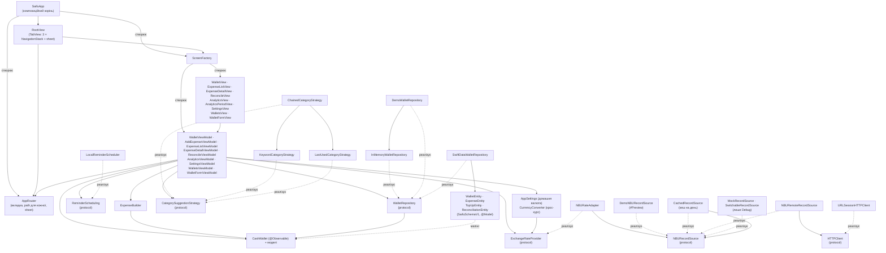

# Архітектура Saifu

Практична робота 2: MVVM, патерни Builder / Strategy / Adapter, принципи SOLID.
Практична робота 3: екрани у трьох вкладках (`TabView`), навігація через `AppRouter`, спільний стан між екранами, темний дизайн (`Theme`). Карта переходів, анімації та сценарій проходження: [navigation.md](navigation.md).
Збереження даних між запусками: SwiftData за протоколом `WalletRepository` (розділ [«Збереження даних»](#збереження-даних)).
Практична робота 4: курси з API НБУ через мережевий шар `Networking/`, стани завантаження в UI, кеш на день (розділ [«Мережевий шар»](#мережевий-шар), детально: [api.md](api.md)).

## Чому MVVM

- **MVC.** У SwiftUI роль контролера відсутня. Логіка опинилася б у `View` або в моделі. Саме так було до рефакторингу: `ContentView` вибирав заголовки рядків і кольори, а `CashWallet` повертав відформатовані рядки.
- **VIPER.** Дає п'ять шарів на кожен екран (View, Interactor, Presenter, Entity, Router). Навіть для п'яти невеликих екранів це багато шаблонного коду без користі. Від VIPER взято лише роутер (`AppRouter`).
- **MVVM.** Підходить до `@Observable` і декларативного UI. View лише показує стан і викликає методи ViewModel. ViewModel отримує залежності через `init`, тому їх легко підміняти. У лабі 3 каркас розширився саме так: кожен новий екран отримав власну ViewModel.

## Схема компонентів

Стрілка означає «залежить від».



View не знають про репозиторій, стратегію, курси й роутер. Усе це доступно лише через їхні ViewModel. Конкретні типи (`SwiftDataWalletRepository` або `DemoWalletRepository`, `ChainedCategoryStrategy`, `NBURateAdapter`, `CachedRecordSource`, `NBURemoteRecordSource`, `URLSessionHTTPClient`, `LocalReminderScheduler`, `AppRouter`) створюються тільки в `SaifuApp`. `ScreenFactory` отримує їх через `init` і збирає з них екрани.

## Навігація: `AppRouter`

- **Стан.** `Saifu/Navigation/AppRouter.swift`, `@Observable`. `selectedTab: AppTab` (Головна, Аналітика, Налаштування), окремий стек для кожної вкладки (`homePath`, `analyticsPath`, `settingsPath: [Route]`) і `sheet: Sheet?`.
- **Маршрути.**
  - `Route.expenseList(walletID:)`, `Route.expenseDetail(walletID:expenseID:)` (push у стек «Головної»).
  - `Sheet.reconcile(walletID:)`, `Sheet.wallets`, `Sheet.analyticsPeriod` (sheet).
  - `WalletsRoute.addWallet`, `WalletsRoute.editWallet(walletID:)` — стек усередині sheet «Гаманці» (`walletsPath`).
  - Маршрути несуть лише ідентифікатори, а не копії моделей.
- **Методи.** `showExpenseList`, `showExpenseDetail`, `pop` (зі стеку поточної вкладки), `presentReconcile`, `presentWallets`, `showAddWallet`, `showEditWallet`, `popWallets`, `presentAnalyticsPeriod`, `dismissSheet`. Переходи відбуваються тільки через них.
- **Хто викликає.** Екран викликає метод своєї ViewModel (наприклад, `allExpensesTapped()`, `backTapped()`), а ViewModel звертається до роутера: `dismissSheet()` після звірки, `pop()` після редагування чи видалення. Вибір вкладки — binding `$router.selectedTab` для `TabView(selection:)`.
- **Прив'язка до SwiftUI.** Лише `RootView` бере binding-и `$router.selectedTab`, `$router.homePath`, `$router.analyticsPath`, `$router.settingsPath` і `$router.sheet`; `WalletsSheet` так само прив'язує `$router.walletsPath`. Панель вкладок нативна: `TabView` з Tab API (iOS 18+, на iOS 17 — `.tabItem`). На iOS 26 система сама дає Liquid Glass і анімацію вибору, а `tabBarMinimizeBehavior(.onScrollDown)` згортає панель при прокручуванні; відступи під панель SwiftUI додає сам. Жест «назад» свайпом від краю повертає `UINavigationController+SwipeBack.swift`, бо на вкладених екранах системну панель навігації сховано.

| Екран | Тип | Звідки відкривається |
|---|---|---|
| `WalletView` | корінь вкладки «Головна» | старт застосунку |
| `AnalyticsView` | корінь вкладки «Аналітика» | панель вкладок |
| `SettingsView` | корінь вкладки «Налаштування» | панель вкладок |
| `ReconcileView` | sheet | «Звірити» на картці гаманця |
| `WalletsView` | sheet | кнопка гаманців у шапці головної або «Керувати гаманцями» в налаштуваннях |
| `WalletFormView` | push у sheet | «Додати гаманець» або тап по гаманцю |
| `AnalyticsPeriodView` | sheet | чип «Період…» в аналітиці |
| `ExpenseListView` | push | «Усі» на головному |
| `ExpenseDetailView` | push | рядок витрати в списку або на головному |

Окремого екрана «+ Витрата» немає: форма швидкого додавання вбудована в головний екран і працює через `AddExpenseViewModel`. `WalletViewModel` отримує від `ScreenFactory` замикання, що створює цю ViewModel, і тримає по одній на гаманець, тож введене не губиться при свайпі між картками.

## Стиль

`Saifu/Views/Theme.swift` — єдине місце для кольорів, радіусів, відступів і шрифтів (системний `.rounded`). Іконки категорій (SF Symbols) і кольори для діаграми задані в `ExpenseCategory+Style.swift` у шарі View, тож модель про вигляд не знає. Спільні компоненти лежать у `Views/Components/`: `AmountField` (поле суми з фільтром `AmountInputFilter`: лише цифри й одна кома, не більше `currency.minorUnits` знаків після неї), `CategoryMenu`, `ChipPicker`, `ExpenseRowView`, `BackButton`, `PageDots`. Клавіатура закривається тапом по порожньому місцю (`dismissKeyboardOnBackgroundTap`), прокручуванням і кнопкою «Готово» на самій клавіатурі (`.submitLabel(.done)`).

## Спільний стан між екранами

- `CashWallet` позначено `@Observable`. Репозиторій повертає ті самі екземпляри, тому всі ViewModel працюють з одним об'єктом гаманця.
- Баланс, рядки та список є обчислюваними властивостями ViewModel. SwiftUI сам відстежує, що читається з гаманця, і перемальовує всі екрани, що від нього залежать.
- Після додавання в sheet, звірки, редагування чи видалення головний екран і список оновлюються без `reload()` і без копіювання даних.
- `ExpenseDetailViewModel` читає витрату з гаманця щоразу за `expenseID`. Якщо витрати вже немає, екран показує «Витрату не знайдено».
- `InMemoryWalletRepository` позначено `@Observable` і має `remove(id:)` та `move(fromOffsets:toOffset:)` (порядок карток). ViewModel читають `repository.wallets()` щоразу, а не копіюють масив в `init`, тому гаманець, доданий, видалений чи переставлений у sheet «Гаманці», одразу з'являється в тому ж порядку у свайп-картках і в меню аналітики.
- У `CashWallet` назва стала змінною, а валюту змінює `changeCurrency(to:)`, лише поки в гаманці немає записів (інакше `WalletError.walletNotEmpty`), бо суми не перераховуються.
- Домашня валюта зберігається в `AppSettings` (`@Observable`, ключ `homeCurrency` у `UserDefaults`, за замовчуванням UAH). `@AppStorage` тут не підходить: його бачать лише View, а «≈ …» рахують ViewModel. Зміна валюти в налаштуваннях одразу перераховує всі екрани.
- `CurrencyConverter` завантажує курси всіх валют через `ExchangeRateProvider` (при запуску й поверненні на передній план, не частіше разу на день) і перераховує суму крос-курсом через гривню (`ExchangeRate.toUAHMinor` / `fromUAHMinor`, `Decimal` без `Double`). Він же тримає `state: LoadState`, тож головна й аналітика однаково показують завантаження чи помилку. Якщо валюта гаманця збігається з домашньою, рядок «≈» і стан курсу не показуються.
- `AnalyticsViewModel` рахує підсумки за період через `CashWallet.totalsByCategory(in: Range<Date>?)`. Необов'язковий діапазон — єдина зміна моделі в редизайні; без нього метод поводиться як раніше. Власний період задається в sheet двома датами з перевіркою «з ≤ по».
- Для редагування до `CashWallet` додано `updateExpense(_:)` і `removeExpense(id:)`. Вони мають ті самі перевірки, що й `addExpense`: `negativeAmount`, а для відсутньої витрати новий `WalletError.expenseNotFound`. Гаманець отримав `id`, і `InMemoryWalletRepository.save` шукає за ним, а не за `name`.

## Збереження даних

Гаманці, витрати, поповнення, звірки й порядок гаманців зберігаються на пристрої між запусками. Налаштування (домашня валюта, нагадування) лишаються в `UserDefaults` через `AppSettings`: це кілька простих значень, і окрема схема для них не потрібна.

### Чому SwiftData

- Входить в iOS 17, яка й так мінімальна для проєкту: жодних сторонніх залежностей.
- Працює зі Swift-класами напряму, без `.xcdatamodeld` і ручного SQL, на відміну від Core Data чи SQLite.
- Версії схеми (`VersionedSchema`) і план міграцій (`SchemaMigrationPlan`) вбудовані, тож майбутні зміни моделі не зламають уже збережені дані.
- Для гаманців і списку записів достатньо локальної бази; синхронізація чи сервер поки не потрібні.

### Окремі сутності замість `@Model` у доменних моделях

Доменні моделі (`CashWallet`, `Expense`, `CashTopUp`, `Reconciliation`, `Currency`, `ExpenseCategory`) лишилися звичайним Swift. Сховище описують окремі класи в `Saifu/Persistence/`:

| Сутність | Поля | Зв'язок |
|---|---|---|
| `WalletEntity` | `id` (унікальний), `name`, `currencyRaw`, `sortIndex` | → витрати, поповнення, остання звірка; усі з каскадним видаленням |
| `ExpenseEntity` | `id`, `amount`, `categoryRaw`, `date`, `note?`, `receiptID?` | `wallet` (зворотний) |
| `TopUpEntity` | `id`, `amount`, `date`, `sourceRaw` | `wallet` |
| `ReconciliationEntity` | `expected`, `actual`, `date` | `wallet` |

Чому так:
- **Домен не залежить від сховища.** `Expense` і `CashTopUp` — `struct` з валідацією в `CashWallet` (`addExpense`, `reconcile` тощо). `@Model` вимагає класів і змінює семантику: зміни йдуть у контекст, а не в значення. Перетворення моделей на `@Model` означало б переписати лаби 1–3.
- **ViewModel і View не знають про SwiftData.** Вони працюють із тими самими `CashWallet`, що й раніше. Замінити SwiftData на щось інше можна, не чіпаючи нічого, крім `Persistence/` і репозиторію.
- **Enum-и зберігаються як `rawValue`** (`Currency`, `ExpenseCategory`, `TopUpSource` мають `String`-значення). Невідома категорія з бази стає `.untracked`, невідоме джерело — `.atm`, тож запис не губиться.
- Ціна такого підходу — мапінг в обидва боки (`Persistence/EntityMapping.swift`: `toDomain()` і `update(from:)`).

### Як працює `SwiftDataWalletRepository`

- **Запуск.** Один раз читає `WalletEntity`, відсортовані за `sortIndex`, перетворює на `CashWallet` і тримає їх у пам'яті. `wallets()` повертає ті самі екземпляри, тому спільний стан між екранами працює як раніше (`@Observable`).
- **Зміни.** ViewModel, як і раніше, змінюють `CashWallet` і викликають `repository.save(wallet)`. Репозиторій синхронізує весь гаманець за `id` (нові записи додає, змінені оновлює, зниклі видаляє) і одразу викликає `context.save()` (автозбереження вимкнене). Якщо одне збереження не вдалося, наступне вдале запише й попередні зміни.
- **Видалення гаманця.** `remove(id:)` видаляє `WalletEntity`, а його витрати, поповнення і звірку прибирає каскадне правило.
- **Порядок.** `move(fromOffsets:toOffset:)` переставляє гаманці в пам'яті й перезаписує `sortIndex` усім. Новий гаманець отримує найбільший `sortIndex + 1`.
- **Помилки.** `save`, `remove` і `move` у протоколі стали `throws`. Якщо `context.save()` падає, репозиторій робить `rollback()` і кидає `RepositoryError.saveFailed`. ViewModel показує «Не вдалося зберегти зміни на пристрої. Спробуйте ще раз» тим самим полем `errorMessage`, що й для помилок валідації (`WalletError.message(for:fallback:)`), тож застосунок не падає. Якщо сховище не відкрилося при запуску, `SaifuApp` переходить на сховище в пам'яті, а `RootView` один раз показує попередження.
- Контейнер створює `SaifuMigrationPlan.makeContainer(inMemory:)`. Репозиторій тримає посилання на `ModelContainer`, бо `ModelContext` його не утримує.

### Міграції

`SaifuSchemaV1` (версія 1.0.0) містить усі чотири сутності, а `SaifuMigrationPlan` перелічує версії схеми. Псевдоніми `WalletEntity = SaifuSchemaV1.WalletEntity` тощо дозволяють решті коду не знати номер версії. Щоб змінити модель: скопіювати сутності в `SaifuSchemaV2`, додати її в `schemas`, додати `MigrationStage.lightweight` (або `.custom` для перетворення даних) у `stages` і перевести псевдоніми на V2.

### Як підміняється репозиторій

| Де | Репозиторій | Дані |
|---|---|---|
| Звичайний запуск (Debug і Release) | `SwiftDataWalletRepository` з контейнером на диску | збережені; перший запуск порожній |
| Debug з аргументом `-uiScreen` (скриншоти) | `DemoWalletRepository` | демо-сценарій у пам'яті, диск не змінюється |
| `#Preview` (`ScreenFactory.preview()`) | `DemoWalletRepository` | демо-сценарій |
| Сховище не відкрилося | `SwiftDataWalletRepository` з контейнером у пам'яті | порожньо, з попередженням |

Вибір зроблено в одному місці, `SaifuApp.makeRepository()`. ViewModel отримують лише протокол.

### Перший запуск

Без гаманців головний екран показує порожній стан із кнопкою «Створити перший гаманець». Вона відкриває наявну форму нового гаманця в sheet «Гаманці» (`WalletViewModel.createFirstWalletTapped()`). В аналітиці замість меню гаманця й періодів з'являється «Створіть гаманець, щоб бачити аналітику». Список витрат без гаманця не відкривається, а порожній гаманець показує «Витрат немає».

## Патерни

### Builder: `ExpenseBuilder`

- **Задача.** Перетворити введення форми (рядок «45,50», необов'язкові категорія й нотатка) на коректну `Expense`. Суму треба перевести в найменші одиниці за `currency.minorUnits` без `Double` і перевірити: сума більша за нуль, категорію задано.
- **Учасники.** `ExpenseBuilder` (будівельник), `Expense` (продукт), `WalletError` (`invalidAmount`, `negativeAmount`, `missingCategory`). Клієнти: `AddExpenseViewModel` (нова витрата) та `ExpenseDetailViewModel` (редагування, з `id(_:)`, `date(_:)`, `receiptID(_:)` наявної витрати, щоб валідація була одна).
- **Особливість.** Методи `amount`, `category`, `note`, `date`, `id`, `receiptID` повертають копію структури, тож будівельник є значенням без прихованого стану. Розбір рядка суми винесено в `Currency.parseMinor`, бо його використовує й `ReconcileViewModel`.
- **Файли.** `Saifu/Builders/ExpenseBuilder.swift`, `Saifu/Models/WalletError.swift`, `Saifu/Models/Currency.swift`, використання в `Saifu/ViewModels/AddExpenseViewModel.swift` і `Saifu/ViewModels/ExpenseDetailViewModel.swift`.

### Strategy: `CategorySuggestionStrategy`

- **Задача.** Підказувати категорію за нотаткою. Спосіб підказки має змінюватися без правок ViewModel.
- **Учасники.**
  - Протокол `CategorySuggestionStrategy` (`suggest(for:)`, `learn(note:category:)` зі стандартною порожньою реалізацією).
  - `KeywordCategoryStrategy(dictionary:)` шукає цілі слова та фрази без урахування регістру, найдовший збіг виграє.
  - `LastUsedCategoryStrategy` пригадує категорію, яку користувач уже обирав для такої нотатки.
  - `CategoryDictionaries` містить дані (`english`, `ukrainian`, `all`).
  - Контекст — `AddExpenseViewModel`.
- **Файли.** `Saifu/Strategies/*.swift`.

#### Роль `ChainedCategoryStrategy`

`AddExpenseViewModel` приймає одну стратегію, а застосунку потрібні дві: спочатку те, що користувач уже обирав, і лише потім словник. `ChainedCategoryStrategy` реалізує той самий протокол і перебирає вкладені стратегії по черзі. Повертається перша відповідь, а `learn` передається всім. Порядок у масиві задає пріоритет. ViewModel не знає, що за стратегією ховається кілька. Так само працює патерн Composite, і це не штучна ієрархія: тип замінює складну умову у ViewModel.

### Adapter: `NBURateAdapter`

- **Задача.** Дані НБУ мають власний формат (`r030`, `txt`, `rate`, `cc`, `exchangedate` у вигляді `dd.MM.yyyy`). Застосунок працює зі своїм типом `ExchangeRate`.
- **Учасники.**
  - `ExchangeRateProvider` — цільовий інтерфейс, його використовує `WalletViewModel`.
  - `NBURecord` — формат, що адаптується.
  - `NBURateAdapter` — адаптер. Невідомий код валюти або дата, що не розбирається, дають `nil`.
  - `NBURecordSource` — джерело записів: `NBURemoteRecordSource` (API НБУ), `CachedRecordSource` (декоратор із кешем на день), `DemoNBURecordSource` (#Preview), `MockRecordSource` (Debug).
  - `NBURateDTO` — формат JSON-відповіді, перетворюється на `NBURecord`.
- **Конвертація.** `ExchangeRate.toUAHMinor` рахує через `Decimal`, без `Double`.
- **Файли.** `Saifu/ExchangeRates/*.swift`.

У лабі 4 адаптер не змінювався: мережа з'явилася як нова реалізація `NBURecordSource`, яку `SaifuApp` підставляє замість демо-джерела.

## SOLID у Saifu

**S: єдина відповідальність.**
- `ExpenseBuilder` лише збирає й перевіряє витрату.
- `NBURateAdapter` лише перетворює формат.
- `EntryRow` лише готує рядок для показу.
- `AppRouter` лише зберігає стан навігації, а `ScreenFactory` лише збирає екрани.
- У лабі 3 `WalletViewModel` розбито: форма перейшла в `AddExpenseViewModel`, звірка в `ReconcileViewModel`, список і деталі мають власні ViewModel. Тексти помилок зібрано в одному місці, `WalletError+Message.swift`.
- Керування гаманцями винесено з налаштувань в окремі `WalletsViewModel` (список, видалення, порядок) і `WalletFormViewModel` (додавання й редагування). `SettingsViewModel` більше не знає про репозиторій: він лише відкриває sheet через роутер і керує домашньою валютою та нагадуваннями.
- `LocalReminderScheduler` лише планує й скасовує локальні сповіщення; коли й скільки нагадувань ставити, вирішує тільки він, а не ViewModel.
  - Нагадування приходять у вибраний час (за замовчуванням 20:00). «Щодня» і «щотижня» — повторюваний `UNCalendarNotificationTrigger` (щотижня — у день тижня, коли ввімкнули). «Раз на 3 дні» календарний тригер виразити не може, тому планується серія з 10 одноразових нагадувань наперед; вона поновлюється при кожному запуску (`RootView.task` → `ScreenFactory.appDidLaunch`) і при зміні часу чи інтервалу. День тижня й ритм серії планувальник бере з уже запланованих запитів, тож окремо їх не зберігає.
- `AppSettings` лише зберігає домашню валюту, `CurrencyConverter` лише перераховує суми.

**O: відкритість до розширення.**
- Новий словник додається у `CategoryDictionaries` одним `static let`, класи стратегій не змінюються.
- Нова стратегія додається в `ChainedCategoryStrategy([...])` у `SaifuApp`.
- Новий екран означає новий випадок `Route`/`Sheet` (або `WalletsRoute` для sheet «Гаманці»), метод роутера та гілку в `ScreenFactory`. Наявні екрани не змінюються.
- Новий інтервал нагадувань — кейс `ReminderInterval` і гілка в `LocalReminderScheduler`; `SettingsViewModel` не змінюється.

**L: підстановка Лісков.**
- Будь-яка реалізація `WalletRepository`, `CategorySuggestionStrategy`, `ExchangeRateProvider` чи `ReminderScheduling` замінює іншу без змін у ViewModel.
- Наприклад, `InMemoryWalletRepository` і `DemoWalletRepository` взаємозамінні, `ChainedCategoryStrategy` сама є стратегією, а `PreviewReminderScheduler` підміняє `LocalReminderScheduler` у `#Preview`.
- Спадкування тут не використовується, тому принцип виявляється лише через протоколи.

**I: розділення інтерфейсів.**
- `NBURecordSource` має один метод, `ExchangeRateProvider` також один.
- `ReminderScheduling` має три методи (дозвіл, планування, скасування), і всі потрібні `SettingsViewModel`.
- `learn(note:category:)` має стандартну порожню реалізацію, тому `KeywordCategoryStrategy` не змушений реалізовувати непотрібне.
- Чесне застереження: `WalletRepository` виріс до чотирьох методів (`wallets`, `save`, `remove`, `move`), а пошук `wallet(id:)` додано стандартною реалізацією в extension. Екрани витрат користуються лише читанням, а `WalletsViewModel` — усім набором. Ділити протокол на «читання» і «керування» поки не варто: реалізації дві, і обидві підтримують усе.

**D: інверсія залежностей.**
- ViewModel залежать від протоколів `WalletRepository`, `CategorySuggestionStrategy`, `ExchangeRateProvider`, `ReminderScheduling` і отримують їх через `init` від `ScreenFactory`. Конкретні реалізації протоколів, `UNUserNotificationCenter` і `UserDefaults` створюються лише в `SaifuApp`; для `#Preview` підставляються `PreviewReminderScheduler` і окремий `UserDefaults(suiteName:)`.
- `AppSettings` і `CurrencyConverter` створює `ScreenFactory` з уже переданих `UserDefaults` і `ExchangeRateProvider`: це спільний стан кількох екранів, а не нова зовнішня залежність.
- Чесне застереження: ViewModel напряму використовують `CashWallet`, `ExpenseBuilder`, `AppRouter`, `AppSettings` і `CurrencyConverter`. У кожного з них єдина реалізація, тож абстракція над ними була б штучною.

## Як замінити джерела без зміни ViewModel

Усі залежності обираються в `Saifu/App/SaifuApp.swift`.

**Репозиторій.** Обирається в `SaifuApp.makeRepository()`:

```swift
// збереження на диску (звичайний запуск)
SwiftDataWalletRepository(container: try SaifuMigrationPlan.makeContainer(inMemory: false))

// лише в пам'яті, порожній старт
InMemoryWalletRepository()

// дані демо-сценарію (гаманці JPY і UAH); так працюють #Preview і -uiScreen
DemoWalletRepository()
```

**Джерело курсів.** Обирається в `SaifuApp.makeRateSource()`; будь-який `NBURecordSource` підставляється в адаптер:

```swift
// API НБУ з кешем на день (Release)
let source = CachedRecordSource(source: NBURemoteRecordSource(client: URLSessionHTTPClient()))
rateProvider: NBURateAdapter(source: source), rateCache: source

// Debug: між кешем і мережею перемикач «Реальне API / режими mock»
CachedRecordSource(source: SwitchableRecordSource(live: remote, defaults: .standard))

// #Preview: демо-курси без мережі
NBURateAdapter(source: DemoNBURecordSource())
```

Так і відбувся перехід на реальні дані в лабі 4: `ExchangeRateProvider` від початку асинхронний, тому `NBURateAdapter` і ViewModel не довелося переписувати під мережу.

## Мережевий шар

- **Де мережа.** URLSession використовується лише в `Saifu/Networking/URLSessionHTTPClient.swift`. `NBURemoteRecordSource` знає тільки протокол `HTTPClient`, View і ViewModel не знають навіть його.
- **Помилки.** `NetworkError`: `transport(URLError)`, `badStatus(Int)`, `decoding(Error)`, `empty`. Статус `HTTPURLResponse` перевіряється до декодування. Тексти для користувача — в `ViewModels/NetworkError+Message.swift`, окремо від мережевого шару.
- **Стан у UI.** `LoadState` (`idle`, `loading`, `loaded`, `empty`, `failed(message)`) живе в `CurrencyConverter` (`@MainActor`), показується компонентом `RateStatusView` на головній і в аналітиці.
- **Потоки.** Запит виконує URLSession поза головним потоком; `await` лише чекає на результат, тож свайпи й введення працюють під час завантаження. Стан змінюється на головному акторі.
- **Кеш.** `CachedRecordSource` зберігає записи на поточний день (київський час) і об'єднує одночасні запити в одне завантаження. Скидається pull-to-refresh, «Повторити» і зміною джерела в Debug.

Endpoint, реальні відповіді й покрокова перевірка всіх станів: [api.md](api.md).

## Таблиця: патерн / принцип, компонент, призначення

| Патерн / принцип | Компонент | Призначення |
|---|---|---|
| MVVM | пари View / ViewModel для кожного екрана, моделі | Розділення показу, стану екрана й домену |
| Router | `AppRouter`, `AppTab`, `Route`, `Sheet`, `RootView` | Усі переходи в одному місці, View не керують навігацією |
| Factory | `ScreenFactory` | Створення екранів і їхніх ViewModel із залежностей кореня |
| Observer | `@Observable CashWallet` | Усі екрани бачать один стан гаманця |
| Repository | `WalletRepository`, `SwiftDataWalletRepository`, `InMemoryWalletRepository`, `DemoWalletRepository` | Джерело гаманців, яке можна підміняти (диск, пам'ять, демо) |
| Data Mapper | `Persistence/EntityMapping.swift` | Перетворення сутностей SwiftData ↔ доменні моделі |
| Builder | `ExpenseBuilder` | Збирання і валідація `Expense` з введення форми |
| Strategy | `CategorySuggestionStrategy`, `KeywordCategoryStrategy`, `LastUsedCategoryStrategy` | Взаємозамінні способи підказати категорію |
| Composite (за роллю) | `ChainedCategoryStrategy` | Кілька стратегій як одна |
| Adapter | `NBURateAdapter` | Формат НБУ → `ExchangeRate` |
| Decorator | `CachedRecordSource` | Кеш на день поверх будь-якого `NBURecordSource` |
| Service за протоколом | `ReminderScheduling`, `LocalReminderScheduler` | Нагадування про звірку, підміна в превʼю |
| Спільний стан | `AppSettings`, `CurrencyConverter` | Домашня валюта і крос-курс для всіх екранів |
| Composition root | `SaifuApp` | Єдине місце створення залежностей |
| S | `ExpenseBuilder`, `NBURateAdapter`, `EntryRow` | Кожен тип має одну задачу |
| O | `CategoryDictionaries` | Новий словник без змін класів |
| L | реалізації протоколів репозиторію, стратегії, курсів | Підстановка без змін ViewModel |
| I | `NBURecordSource`, `HTTPClient`, `RateCacheInvalidating`, `learn` зі стандартною реалізацією | Вузькі інтерфейси |
| D | усі ViewModel | Залежність від протоколів, а не від конкретних типів |

## Антипатерни: було → стало

Перевірка коду на антипатерни дала такі виправлення (коміт «Fix antipatterns found in architecture review»).

| Що | Було | Стало |
|---|---|---|
| Надмірна відповідальність | `WalletViewModel` сам збирав рядки операцій (заголовок, емодзі, знак, текст суми) двома блоками майже однакового коду | Рядки будують `EntryRow.init(topUp:currency:)` та `EntryRow.init(expense:currency:)` у `ViewModels/EntryRow.swift`, ViewModel лише викликає їх |
| UI з прямим доступом до даних | `WalletViewModel.wallets` та `selectedWallet` були доступні ззовні, тож `View` міг дістатися до `CashWallet` | Обидві властивості `private`, `View` бачить лише `walletNames`, `balanceText`, `rows` та інший готовий стан |
| Дублювання | Злиття словників `english` та `ukrainian` повторювалось у `SaifuApp` і в `#Preview` | Одне місце: `CategoryDictionaries.all` |
| Прихована залежність | `DemoWalletRepository.init()` всередині викликав `DemoScenario.run()`, залежність не було видно в сигнатурі | `init(wallets: [CashWallet] = DemoScenario.run())`: залежність явна, її можна замінити |

**Чого в коді немає і чому.**
- **Синглтони та змінний статичний стан** відсутні. Статичні значення (`CategoryDictionaries`, форматувальник дати в `NBURateAdapter`) є незмінними константами. `DemoScenario.run()` — статична функція без стану, вона лише будує й повертає дані.
- **Прямий доступ UI до даних.** Кожен View бачить тільки свою ViewModel.

**Що свідомо залишено.**
- `CashWallet.formattedBalance` та `expenseSummaries()` повертають відформатовані рядки, тобто презентація лишилась у доменній моделі. Умова лаби 2 забороняє переписувати моделі, а ці методи документовані у README лаби 1 як демонстрація конструкцій Swift.
- Цикл піднесення 10 до степеня `minorUnits` повторюється в `Currency.format`, `parseMinor` та `inputText`. Тепер усі три копії в одному типі.
- `Date()` і `UUID()` використовуються як значення за замовчуванням у `Expense`, `CashTopUp`, `CashWallet` та `ExpenseBuilder`. Для тестів дату можна передати явно (`.date(_)`).
- `CashWallet` є посилальним типом, тому `repository.save` у `InMemoryWalletRepository` лише закріплює вже внесену зміну. У `SwiftDataWalletRepository` саме цей виклик записує зміну на диск.
