# Навігація та інтерфейс Saifu

Практична робота 3: екрани застосунку, переходи між ними через `AppRouter`, спільний стан і власні анімації. Загальна архітектура (MVVM, патерни, SOLID): [architecture.md](architecture.md).

## Карта переходів

Три вкладки нативного `TabView`, у кожної свій `NavigationStack`. Суцільна стрілка — push у стеку, пунктирна — sheet.

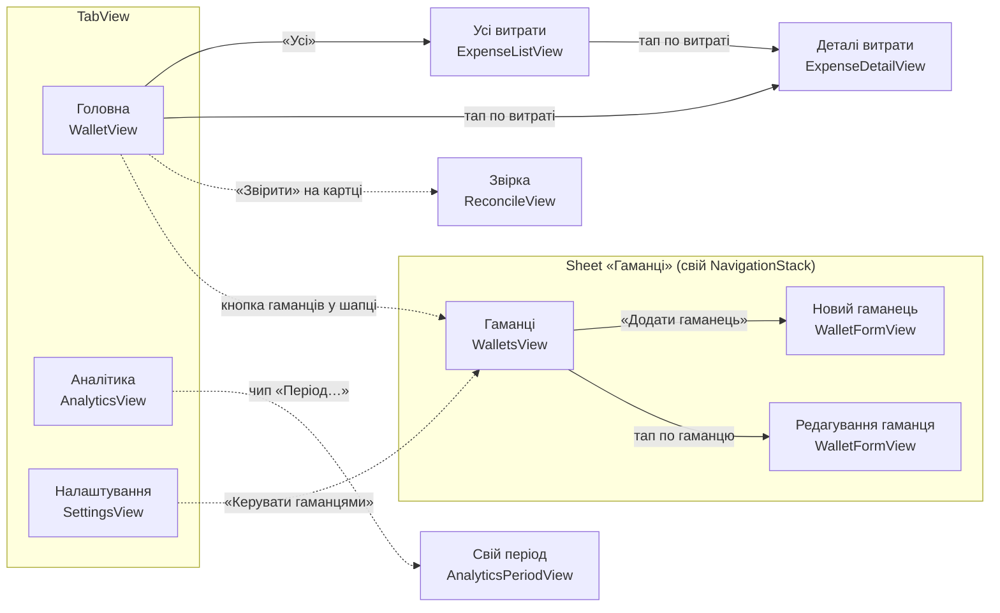

| Екран | Тип переходу | Метод роутера | Що передається |
|---|---|---|---|
| `WalletView`, `AnalyticsView`, `SettingsView` | вкладка | `selectedTab` (binding `TabView`) | — |
| `ExpenseListView` | push у стек «Головної» | `showExpenseList(walletID:)` | ID гаманця |
| `ExpenseDetailView` | push у стек «Головної» | `showExpenseDetail(walletID:expenseID:)` | ID гаманця й витрати |
| `ReconcileView` | sheet | `presentReconcile(walletID:)` | ID гаманця |
| `WalletsView` | sheet | `presentWallets()` | — |
| `WalletFormView` (новий) | push у стек sheet | `showAddWallet()` | — |
| `WalletFormView` (редагування) | push у стек sheet | `showEditWallet(walletID:)` | ID гаманця |
| `AnalyticsPeriodView` | sheet | `presentAnalyticsPeriod()` | та сама `AnalyticsViewModel` |

Повернення: `pop()` знімає верхній екран зі стеку поточної вкладки (після збереження чи видалення витрати), `popWallets()` повертає зі форми до списку гаманців, `dismissSheet()` закриває будь-який sheet. Свайп від лівого краю також повертає назад (`UINavigationController+SwipeBack.swift`), бо на вкладених екранах системну панель навігації замінено власною кнопкою «назад».

## Місце `AppRouter` в архітектурі

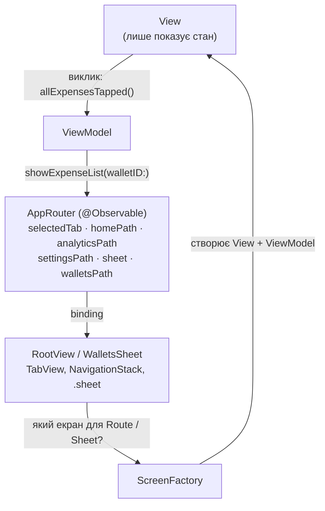

- **Стан.** `AppRouter` (`Saifu/Navigation/AppRouter.swift`) зберігає обрану вкладку `selectedTab`, окремий шлях для кожної вкладки (`homePath`, `analyticsPath`, `settingsPath: [Route]`), поточний `sheet: Sheet?` і стек усередині sheet «Гаманці» (`walletsPath: [WalletsRoute]`). Окремі шляхи означають, що кожна вкладка пам'ятає, де користувач зупинився.
- **Хто змінює.** Лише методи роутера. View їх не викликає: вона звертається до своєї ViewModel (`rowTapped`, `reconcileTapped`, `manageWalletsTapped`, `backTapped`), а та вирішує, куди йти. Так ViewModel, наприклад, після збереження витрати сама робить `pop()`.
- **Прив'язка до SwiftUI.** Тільки `RootView` бере binding-и `$router.selectedTab`, `$router.homePath` тощо, а `WalletsSheet` — `$router.walletsPath`. Для кожного `Route`, `Sheet` чи `WalletsRoute` вони питають `ScreenFactory`, який екран показати. Решта View про роутер не знають.
- **Звідки береться.** Роутер створюється один раз у композиційному корені `SaifuApp` і передається у `ScreenFactory`, а звідти через `init` у ViewModel.

## Як передаються дані

- **Лише ідентифікатори.** Маршрути несуть `UUID` гаманця та витрати (`Route.expenseDetail(walletID:expenseID:)`), а не копії моделей. Нова ViewModel за цим ID бере гаманець з `WalletRepository` (`repository.wallet(id:)`), а витрату — з гаманця (`wallet.expense(with:)`).
- **Один екземпляр гаманця.** `CashWallet` — клас, а репозиторій повертає ті самі екземпляри. Тож головна, список, деталі, звірка й аналітика працюють з одним і тим самим об'єктом.
- **Чому попередні екрани оновлюються самі.** `CashWallet` позначено `@Observable`. Баланс, рядки списку й підсумки — обчислювані властивості ViewModel, які читають гаманець, і SwiftUI запам'ятовує, що саме прочитав кожен екран. Коли деталі змінюють витрату або звірка додає запис «Невідстежене», головна й список перемальовуються без `reload()`, колбеків і копіювання даних. Так само `@Observable InMemoryWalletRepository` оновлює картки й меню аналітики, коли гаманець додано, видалено чи переставлено, а `@Observable AppSettings` перераховує «≈ …» при зміні домашньої валюти.
- **Витрата, якої вже немає.** `ExpenseDetailViewModel` щоразу читає витрату з гаманця за ID. Якщо її видалили, екран показує «Витрату не знайдено», а не застарілу копію.

## Власні анімації

| Анімація | Де | Як зроблено |
|---|---|---|
| Зміна балансу «по цифрах» | картка гаманця, «Разом за фільтром», аналітика | `.contentTransition(.numericText())` + `.animation(.snappy, value:)`. Спрацьовує при додаванні, редагуванні й видаленні витрати, звірці та зміні домашньої валюти |
| Бейдж звірки | `ReconcileView` | Капсула з'являється (`.scale` + `.opacity`) і змінює колір за станом: зелений «Сходиться», помаранчевий «Недостача», синій «Надлишок». Іконка міняється через `.symbolEffect(.replace)`, сума — через `numericText`, усе в `.spring` |
| Перетікання між гаманцями | головна | `TabView(.page)` зі свайпом по картці; індикатор `PageDots` плавно витягує активну крапку (`.animation(.snappy, value: index)`) |
| Поява нової витрати | «Останні витрати», «Усі витрати» | Після «+» рядок в'їжджає зверху: `.transition(.move(edge: .top).combined(with: .opacity))`, запуск через `withAnimation(.snappy)` |
| Діаграма й картки категорій | аналітика | При зміні гаманця чи періоду сектори й картки перебудовуються з `.animation(.snappy, value: stats)` |
| Чипи-фільтри | усі витрати, аналітика, форма гаманця | Активний чип плавно стає білим (`withAnimation(.snappy)`) |

Панель вкладок окремої анімації не має: на iOS 26 Liquid Glass, анімацію вибору й згортання при прокручуванні (`tabBarMinimizeBehavior(.onScrollDown)`) дає система.

## Сценарій проходження

Демо-дані: гаманці «Єни» (15 100 ¥ після звірки) і «Гривні» (954,50 ₴). Звичайний запуск зберігає дані на диску й уперше стартує без гаманців, тому для цього сценарію застосунок запускається в Debug з аргументом `-uiScreen` (наприклад, `-uiScreen home`), і тоді працює з демо-даними в пам'яті (див. [«Збереження даних»](architecture.md#збереження-даних)).

1. **Головна.** Запустити застосунок. Угорі привітання, картка «Єни · JPY» з балансом 15 100 ¥ і «≈ 4 077,00 ₴».
2. **Перемикання гаманця.** Свайпнути картку ліворуч — з'явиться «Гривні · UAH», крапка-індикатор переїде. Рядка «≈» немає, бо валюта збігається з домашньою. Свайпнути назад.
3. **Швидке додавання.** У полі «Сума» ввести `500` (спробувати вставити літери чи кому — для єн вони не з'являться). У «Нотатка» ввести `7-Eleven`: категорія сама зміниться на «Магазин біля дому». Натиснути «+» — клавіатура закриється, баланс анімовано стане 14 600 ¥, витрата в'їде вгорі «Останніх витрат».
4. **Усі витрати.** Натиснути «Усі». Картка «Разом за фільтром» показує суму й кількість, нижче чипи категорій і список за днями. Вибрати чип «Їжа» — сума й список зміняться.
5. **Деталі.** Тапнути по витраті «Обід». Змінити суму на `1000`, натиснути «Зберегти» — екран повернеться назад, а список і баланс на головній оновляться самі. Відкрити витрату ще раз і видалити її з підтвердженням — екран сам повернеться до списку. На головну повернутися свайпом від лівого краю або кнопкою «назад».
6. **Звірка.** На картці натиснути «Звірити». Ввести суму, меншу за баланс, — бейдж стане помаранчевим «Недостача …»; більшу — синім «Надлишок …»; рівну — зеленим «Сходиться». Натиснути «Підтвердити»: баланс стане рівним введеній сумі, а недостача з'явиться як «Невідстежене».
7. **Гаманці.** Натиснути кнопку гаманця праворуч від «Saifu».
   - «Додати гаманець» → назва `Долари`, валюта USD, початкова сума `100,50` → «Створити». Новий гаманець одразу з'явиться третьою карткою на головній.
   - «Змінити» → перетягнути «Долари» вгору → «Готово». Порядок карток на головній і в меню аналітики зміниться.
   - Свайп ліворуч по гаманцю → «Видалити» → підтвердити. Останній гаманець видалити не можна.
   - «Закрити».
8. **Аналітика.** Вкладка «Аналітика»: кругова діаграма з сумою в центрі, «≈ … ₴» і найбільша категорія. Перемкнути гаманець у меню «Єни · JPY ▾» і період «Тиждень / Місяць / Усе». «Період…» → вибрати дати «з» і «по» (якщо «з» пізніше, з'явиться помилка) → «Застосувати»; у центрі діаграми буде діапазон дат.
9. **Налаштування.** Вкладка «Налаштування»: змінити домашню валюту на EUR — «≈ …» на картках і в аналітиці перерахується в євро. Увімкнути «Нагадувати звірити гаманець», дозволити сповіщення, вибрати інтервал і час. Унизу — версія застосунку.

## Скриншоти

iPhone 13 Pro (6,1″) і iPhone SE 3-го покоління (4,7″, кнопка Home), iOS 27.2. Знято через `xcrun simctl io <пристрій> screenshot` з Debug-збірки. Потрібний екран відкривається аргументом запуску `-uiScreen <назва>` (лише Debug, `ScreenFactory.openScreenFromLaunchArguments`), наприклад:

```sh
xcrun simctl launch booted com.vitaliilazariev.Saifu -uiScreen analytics
xcrun simctl io booted screenshot docs/screenshots/iphone13pro-analytics.png
```

Назви: `expenses`, `detail`, `reconcile`, `analytics`, `period`, `settings`, `wallets`, `newWallet`; без аргументу — головна.

| Екран | iPhone 13 Pro | iPhone SE |
|---|---|---|
| Головна | 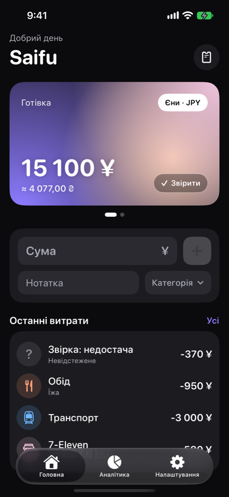 | 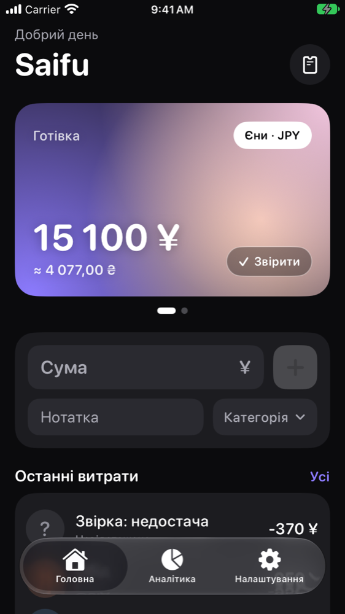 |
| Усі витрати | 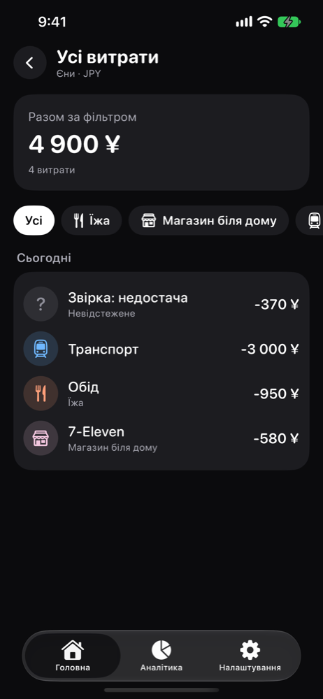 | 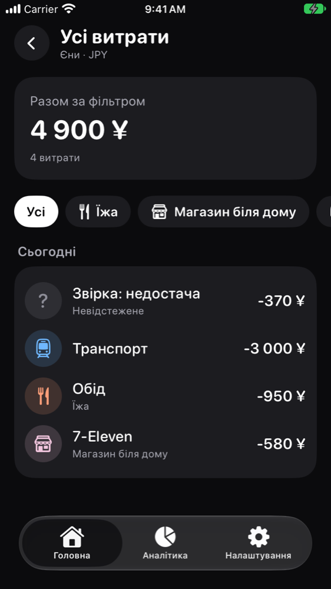 |
| Деталі витрати | 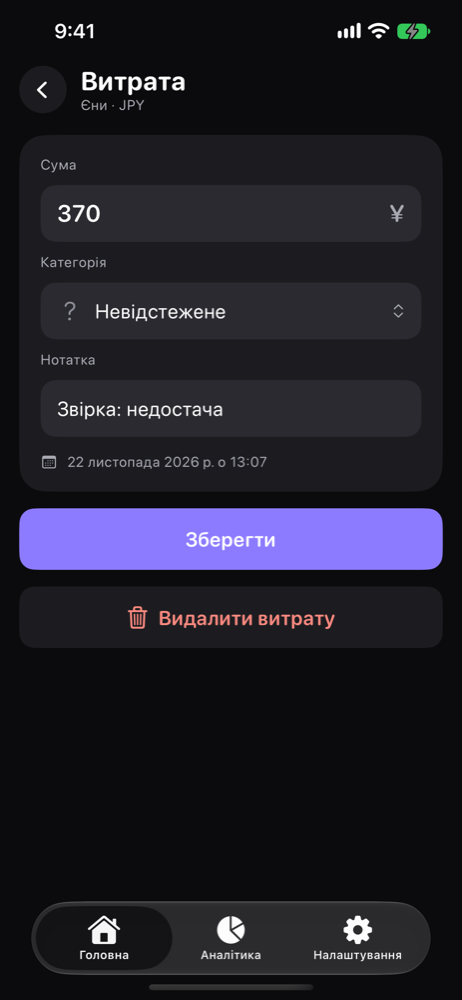 | 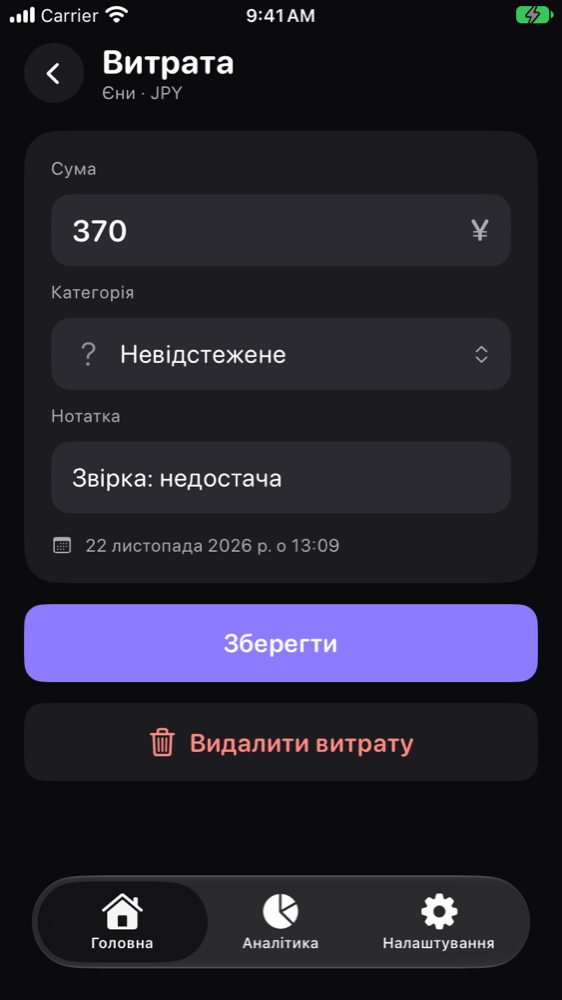 |
| Звірка | 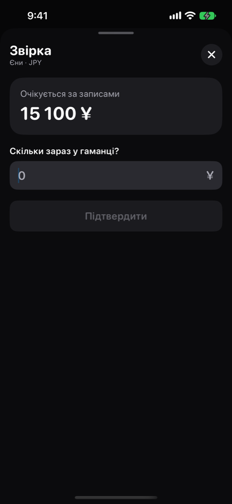 | 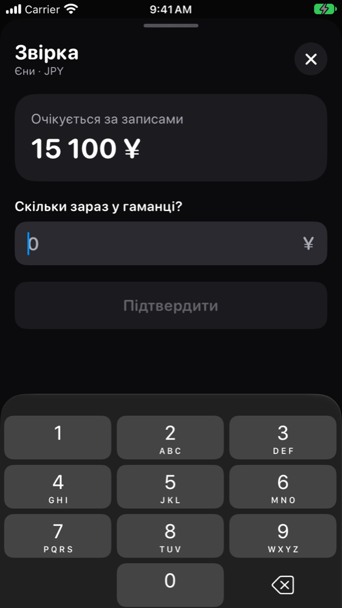 |
| Аналітика | 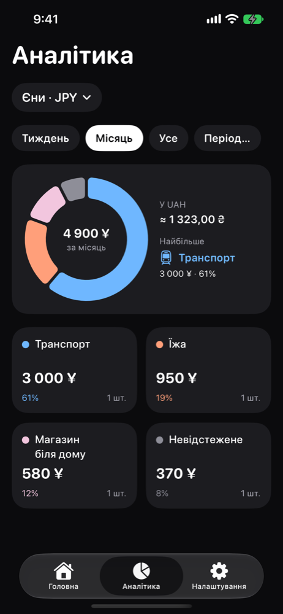 | 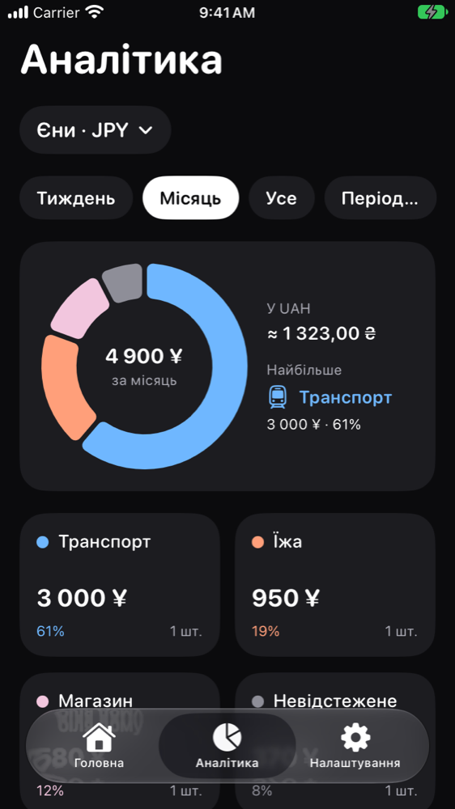 |
| Свій період | 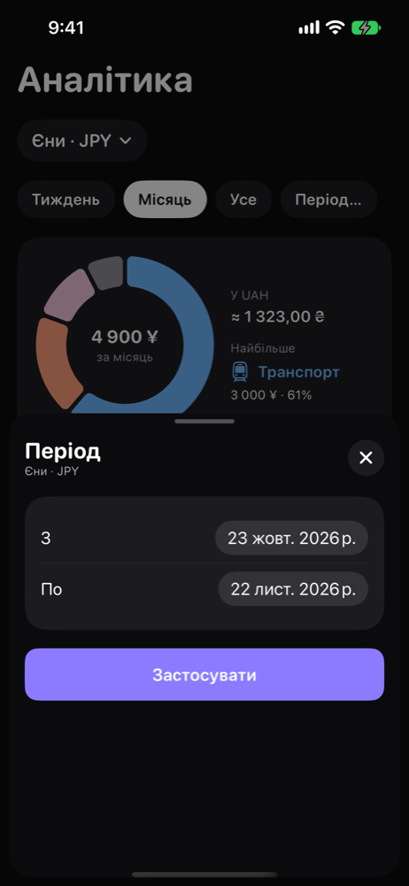 | 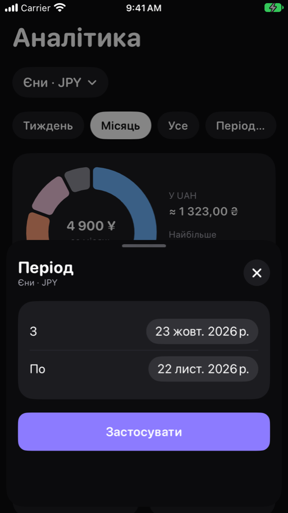 |
| Налаштування | 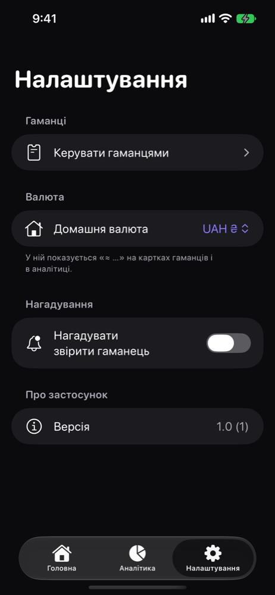 | 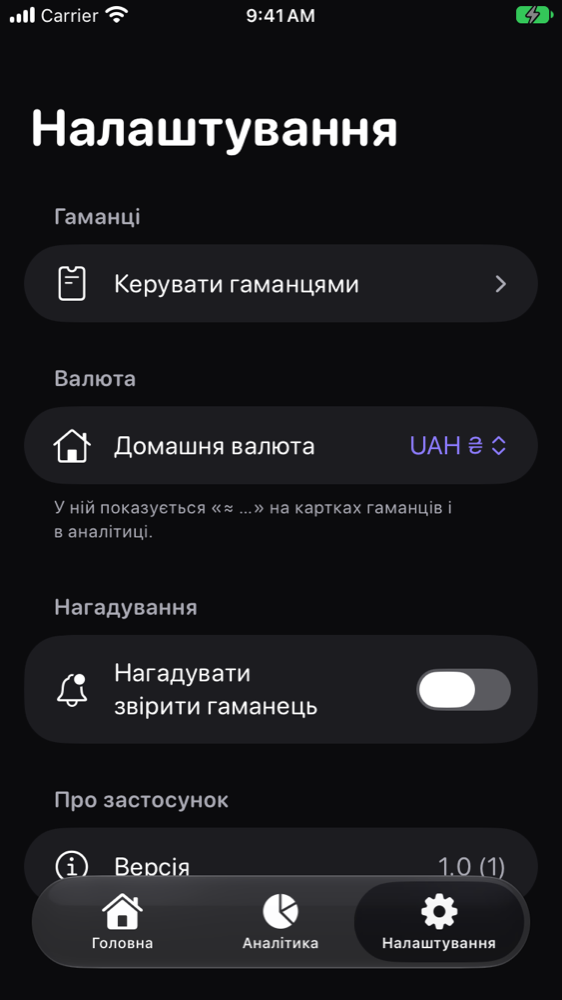 |
| Гаманці | 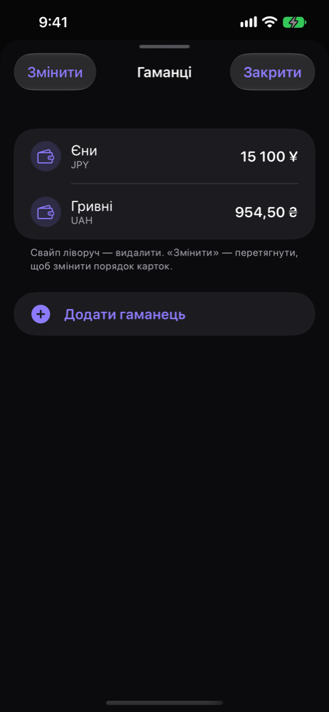 | 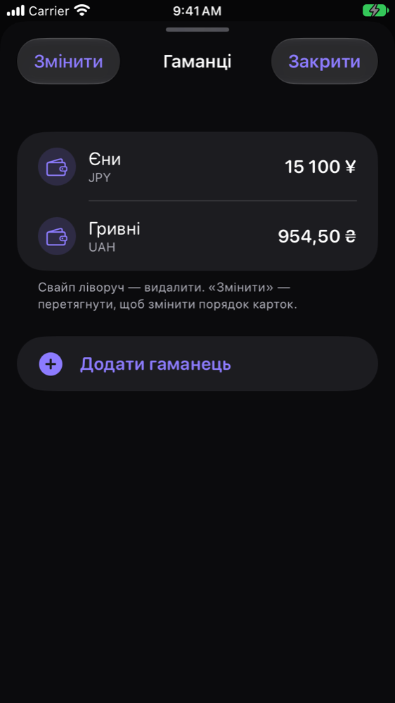 |
| Новий гаманець | 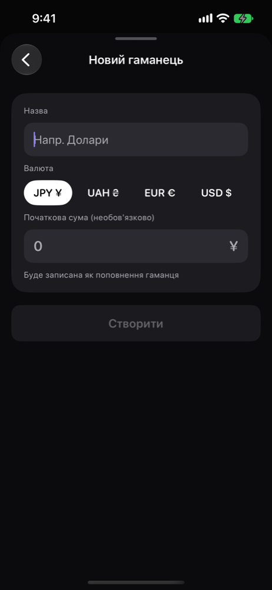 | 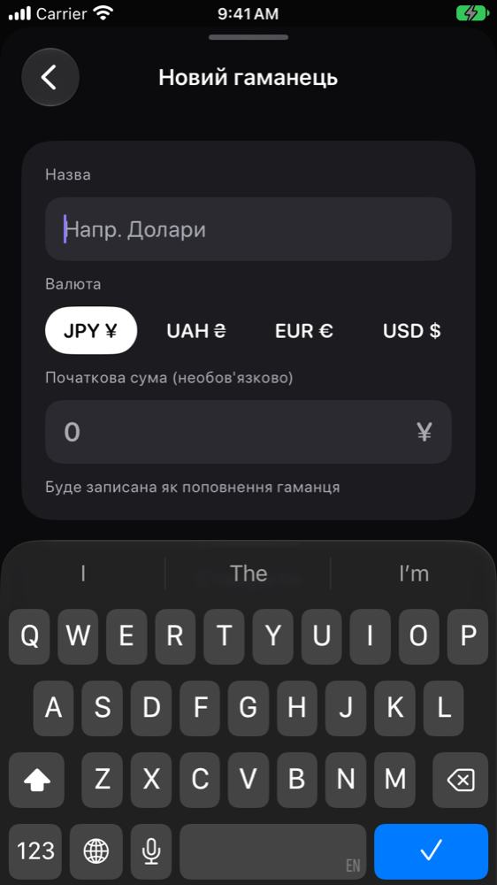 |

### Перевірка на двох розмірах

- Текст не обрізається й не перекривається. На SE назва найбільшої категорії в аналітиці раніше ламалася посеред слова, тепер вона переноситься по словах, а підпис «≈» скорочено до «У UAH» (коміт «Fix small-screen analytics labels…»).
- Клавіатура не закриває поля: на SE у звірці й формі гаманця поле з фокусом і кнопка лишаються над клавіатурою. На знімках 13 Pro клавіатури немає, бо симулятор використовує апаратну клавіатуру Mac.
- Панель вкладок не перекриває контент: останні рядки списків прокручуються над нею (SwiftUI сам додає відступ під `TabView`).
